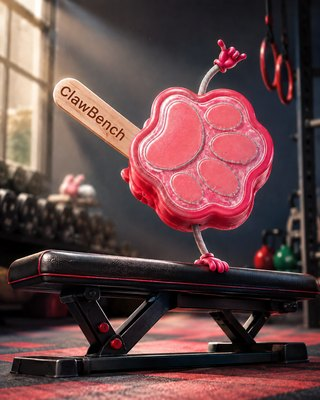
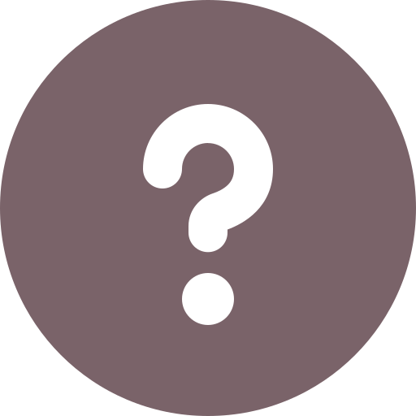
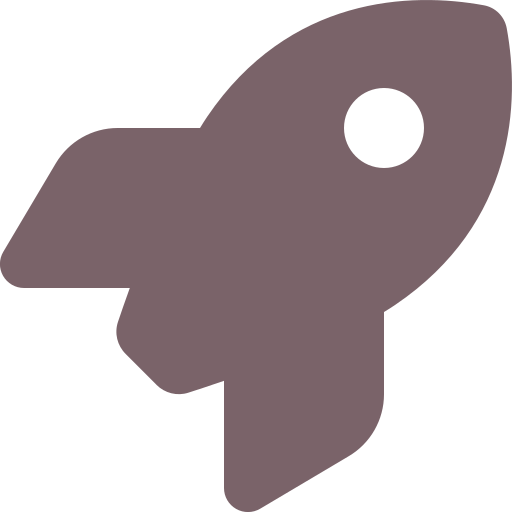
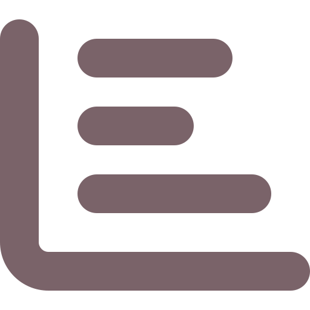

<div align="center">

<p>
<picture>
  <source media="(prefers-color-scheme: dark)" srcset="assets/brand/wordmark-dark.svg">
  
</picture>
</p>

<p>
<picture>
  <source media="(prefers-color-scheme: dark)" srcset="assets/brand/tagline-dark.svg">
  
</picture>
</p>

[](https://claw-bench.com) [](https://arxiv.org/abs/2604.08523) [](https://huggingface.co/spaces/TIGER-Lab/ClawBench) [](https://huggingface.co/datasets/NAIL-Group/ClawBench)

[Quick start](#quick-start) · [Results](#results) · [Docs](docs/README.md) · [Citation](#citation) · [中文](docs/README.zh-CN.md) · [WebsiteBench](https://github.com/TIGER-AI-Lab/WebsiteBench)

</div>



ClawBench is an open-source benchmark, published in Findings of EMNLP 2026, that evaluates AI browser agents on everyday online tasks — booking travel, ordering food, applying for jobs, managing email — across live websites. It records five layers of evidence and supports request-based scoring and trajectory evaluation against human references. In the historical V1 paper evaluation, the strongest evaluated agent completed about 1 in 3 tasks.

**V1:** 152 tasks · 143 live sites &nbsp;|&nbsp; **V2:** 129 tasks · 63 live sites &nbsp;|&nbsp; **281** tasks across **163** live websites · **15** life categories

<sub>Built by NAIL Group · Sister project: [WebsiteBench](https://github.com/TIGER-AI-Lab/WebsiteBench) — Evaluation of agents' ability in reverse-engineering websites · Runs on any Chrome.</sub>

<sub>Featured in 37 curated lists and #3 Paper of the Day on Hugging Face: [`docs/featured.md`](docs/featured.md).</sub>

<br clear="right">

<a id="what-are-you-looking-for"></a>

##  What are you looking for?

| I want to… | Start here |
| --- | --- |
|  Run my model | [Quick start](#quick-start) |
|  See scores | [Live leaderboard](https://huggingface.co/spaces/TIGER-Lab/ClawBench) · [Results](#results) |
|  Browse the tasks | [Task explorer](https://claw-bench.com/tasks) · [Datasets](#datasets) |
|  Reproduce a score | [Reproduction workflow](docs/reproduce.md) · [Trace cookbook](docs/trace-cookbook.md) |
|  Understand the benchmark | [Paper](https://arxiv.org/abs/2604.08523) · [FAQ](docs/faq.md) · [How ClawBench compares](docs/comparison.md) |
|  Change the framework or add tasks | [Source layout](src/README.md) · [Contributing](CONTRIBUTING.md) |

All guides and integrations: **[Documentation index](docs/README.md)**.

<a id="quick-start"></a>
<a id="-human-quick-start"></a>
<a id="human-quick-start"></a>

## Quick start

**Prerequisites:** Python 3.11+, [uv](https://docs.astral.sh/uv/), and a running
Docker or Podman engine. See [platform setup](docs/getting-started.md#prerequisites).

<a id="install"></a>

### Installed package

Install [`clawbench-eval`](https://pypi.org/project/clawbench-eval/) from PyPI:

```bash
uv tool install clawbench-eval
clawbench
```

Launch from the directory where you want your configuration and results.
The interactive TUI guides you through adding a model and selecting a task.
Configure the default judge, `deepseek-v4-pro`, as well; the
[model setup guide](docs/getting-started.md#configure-models) explains judge
selection and how to run without scoring.

### Source checkout

```bash
git clone https://github.com/TIGER-AI-Lab/ClawBench.git
cd ClawBench
cp models/models.example.yaml models/models.yaml
# Edit models/models.yaml with your model and judge API settings.
uv run clawbench
```

`./run.sh` is a shortcut for the same TUI. For a non-interactive run from the
checkout:

```bash
uv run clawbench-run test-cases/v1/886-entertainment-hobbies-experience-topgolf your-provider-model-id
```

Replace `your-provider-model-id` with a configured model key. The first run
builds container images; the local browser's printed noVNC URL lets you watch
the agent. Recordings and metadata land under `test-output/`.

<a id="1-configure-models"></a>
<a id="2-run-your-first-task"></a>
<a id="3-pick-a-harness"></a>
<a id="4-other-browser-runtimes-and-frameworks"></a>

Continue with the **[getting started guide](docs/getting-started.md)** for
batch and human runs, [harness selection](docs/getting-started.md#choose-a-harness),
and remote browser options. The **[CLI reference](docs/cli.md)** covers
non-interactive commands. Coding agents can start with [`AGENTS.md`](AGENTS.md).

## How it works

```
   You pick a task            ClawBench spins up           Agent drives the         Interceptor captures
   from V1 or V2              an isolated Docker           browser: navigates,      every action across
   everyday scenarios         container + Chromium         fills forms, clicks      all 5 layers of data

   ┌──────────────┐           ┌──────────────┐           ┌──────────────┐           ┌──────────────┐
   │  "Book a pet │    ──►    │   Container  │    ──►    │   AI Agent   │    ──►    │   5 layers   │
   │   sitter on  │           │  + Chromium  │           │  browses the │           │  intercepted │
   │   Rover"     │           │  + Agent     │           │   live site  │           │  & recorded  │
   └──────────────┘           └──────────────┘           └──────────────┘           └──────────────┘
```

Live websites · isolated containers · request interception · five-layer recording.

<details>
<summary><b>Container internals</b></summary>

```
┌─────────────────────────────────────────────────┐
│  Container (Docker / Podman)                    │
│                                                 │
│  ┌──────────┐  CDP Fetch/Runtime/Page events    │
│  │ Chromium ├─────────────────────────────┐     │
│  │ :9222 CDP│                             │     │
│  └──────────┘                             │     │
│                                           │     │
│  ┌──────────┐            ┌────────────────▼─┐   │
│  │  Xvfb    │◄──ffmpeg──►│  FastAPI Server  │   │
│  │ :99      │  x11grab   │  :7878           │   │
│  └──────────┘            └──────────────────┘   │
│                                  │              │
│                          ┌───────▼─────────┐    │
│                          │     /data       │    │
│                          │  actions.jsonl  │    │
│                          │  requests.jsonl │    │
│                          │  screenshots/   │    │
│                          │  recording.mp4  │    │
│                          └─────────────────┘    │
└─────────────────────────────────────────────────┘
```

</details>

<a id="datasets"></a>

## Datasets

ClawBench ships **three** Hugging Face datasets — task definitions plus full execution traces for V1 and V2. All open, downloadable in one command.

| Dataset | What's in it | Get it |
| --- | --- | --- |
| **[NAIL-Group/ClawBench](https://huggingface.co/datasets/NAIL-Group/ClawBench)** _(mirrored at [TIGER-Lab/ClawBench](https://huggingface.co/datasets/TIGER-Lab/ClawBench))_ | Task definitions, rubrics, and metadata for V1 and V2 — what to attempt and how it's judged. | `hf download --repo-type dataset NAIL-Group/ClawBench` |
| **[NAIL-Group/ClawBenchV1Trace](https://huggingface.co/datasets/NAIL-Group/ClawBenchV1Trace)** | One directory per V1 model run: `recording.mp4`, `requests.jsonl`, `actions.jsonl`, `agent-messages.jsonl`, `interception.json`, `run-meta.json`. | `hf download --repo-type dataset NAIL-Group/ClawBenchV1Trace` |
| **[TIGER-Lab/ClawBenchV2Trace](https://huggingface.co/datasets/TIGER-Lab/ClawBenchV2Trace)** | Same 5-layer bundle for **V2** runs. Rolling — new models added as they're evaluated. | `hf download --repo-type dataset TIGER-Lab/ClawBenchV2Trace` |

> **Build with the traces:** See the [Trace Cookbook](docs/trace-cookbook.md) for download recipes, data schemas, and research directions.

> The trace datasets are large; use `hf download --include "<pattern>"` to pull a single model or a single task.

> **Live leaderboard:** [`claw-bench.com/leaderboard`](https://claw-bench.com/leaderboard) (V2 default, two-stage scoring — interception + LLM judge). Full scoring formula in [`eval/scoring.md`](eval/scoring.md). Add your run: PR to [`leaderboard/results.csv`](https://huggingface.co/datasets/TIGER-Lab/ClawBench/blob/main/leaderboard/results.csv).

## News

- **[2026.11.05]** — Check out our new project: [WebsiteBench](https://github.com/TIGER-AI-Lab/WebsiteBench) — Evaluation of agents' ability in reverse-engineering websites.
- **[2026.10.10]** — ClawBench has surpassed **[1,000 GitHub stars](https://github.com/TIGER-AI-Lab/ClawBench/stargazers)**! Thank you to everyone who has starred, used, and contributed to the benchmark.
- **[2026.08.20]** — Our paper has been accepted to [EMNLP 2026 Findings](https://2026.emnlp.org/).

Earlier updates are in [`docs/news.md`](docs/news.md); the full change history is in [`CHANGELOG.md`](CHANGELOG.md).

<a id="awesome-works-using-clawbench"></a>

## Awesome Works using ClawBench

**Authors from Google DeepMind, Stanford, UC Berkeley, Google, Microsoft Research, Harvard, ETH Zürich, Oxford, Northwestern, ByteDance Seed, and HKUST build on ClawBench** — and Li Auto's Mach-Mind-4-Flash technical report evaluates on it.

- **Google DeepMind, University of Oxford & Columbia University**, [The Recipe for Intelligence in Natural and Artificial Systems](https://osf.io/preprints/psyarxiv/x9ktv_v1/) ([DOI](https://doi.org/10.31234/osf.io/x9ktv_v1))
- **Stanford, UC Berkeley, Microsoft Research & UCSB**, [Auditing Agent Harness Safety](https://arxiv.org/abs/2605.14271) ([Code](https://github.com/UCSB-AI/HarnessAudit), [Project](https://harnessaudit.github.io/))
- **Google**, [Agentic Coding Needs Proactivity, Not Just Autonomy](https://arxiv.org/abs/2605.06717) ([Google Research Blog](https://developers.googleblog.com/en/measuring-what-matters-with-jules/))
- **Harvard Kempner Institute, Massachusetts General Hospital & CUHK**, [NeuroClaw Technical Report](https://arxiv.org/abs/2604.24696) ([Code](https://github.com/CUHK-AIM-Group/NeuroClaw), [Project](https://cuhk-aim-group.github.io/NeuroClaw/))
- **ETH Zürich & Handshake AI Research**, [Verifying Agents in Rubric-Graded Environments](https://openreview.net/pdf?id=ayA2tJNDET) ([Code](https://github.com/Handshake-AI-Research/gandalf-the-grader), [Workshop](https://rl-eval.github.io/))
- **University of Oxford, NUS & Peking University**, [OpenClaw Research: A Systematic Survey of Large Language Model Agents in Open Deployment](https://openreview.net/forum?id=5PMzjzEy6J) ([Project](https://ykc1.github.io/OpenClaw_Survey_Web/), [Resources](https://github.com/shuolucs/Awesome-OpenClaw-Research))
- **Northwestern University**, [A Survey of the OpenClaw Ecosystem: From Platform Extensibility to Constraint Design](https://openreview.net/pdf/eab5a52b7bba57e22707282587f78e482b44d9b0.pdf) ([Project & Resources](https://github.com/REAL-Lab-NU/Awesome-OpenClaw-Papers))
- **UC Davis & UT Dallas**, [Toward Trustworthy Computer-Use Agents: Risk Propagation, Evaluation Gaps, and Human Governance](https://www.researchgate.net/publication/405422774_Toward_Trustworthy_Computer-Use_Agents_Risk_Propagation_Evaluation_Gaps_and_Human_Governance) ([Code & Project](https://github.com/xu-hu-2002/Toward-Trustworthy-Computer-Use-Agent-A-Survey), [Resources](https://huggingface.co/datasets/Xu-Hu-2002/Toward-Thustworthy-Computer-Use-Agent))

<details>
<summary><b>9 more works</b></summary>

- **ByteDance Seed & HKUST**, [Training Long-Context Vision-Language Models Effectively with Generalization Beyond 128K Context](https://arxiv.org/abs/2605.13831) ([Models](https://huggingface.co/collections/ZhaoweiWang/mmprolong))
- **Tencent Hunyuan & Fudan University**, [TurnOPD: Making On-Policy Distillation Turn-Aware for Efficient Long-Horizon Agent Training](https://arxiv.org/abs/2607.05804)
- **Unipat AI**, [VibeSearchBench: Benchmarking Long-horizon Proactive Search in the Wild](https://arxiv.org/abs/2605.27882) ([Code](https://github.com/VibeBench/VibeSearchBench), [Project](https://vibebench.github.io/VibeSearchBench.github.io/))
- **Tsinghua University & CUHK**, [WildClawBench: A Benchmark for Real-World, Long-Horizon Agent Evaluation](https://arxiv.org/abs/2605.10912) ([Code](https://github.com/InternLM/WildClawBench), [Project](https://internlm.github.io/WildClawBench/))
- **NUS, HKUST, Tsinghua University & Peking University**, [Towards Long-Horizon Agents: A Survey](https://openreview.net/forum?id=HyhfhlbWGh) ([Project](https://long-horizon-agents.github.io/), [Resources](https://github.com/RUC-NLPIR/Awesome-Long-Horizon-Agents))
- **HKU MMLab**, [UniClawBench: A Universal Benchmark for Proactive Agents on Real-World Tasks](https://arxiv.org/abs/2607.08768) ([Code](https://github.com/HKU-MMLab/UniClawBench), [Project](https://uniclawbench.github.io/))
- **Tsinghua University & SJTU**, [MacAgentBench: Benchmarking AI Agents on Real-World macOS Desktop](https://arxiv.org/abs/2606.22557) ([Code](https://github.com/JetAstra/MacAgentBench), [Project](https://jetastra.github.io/MacAgentBench/))
- **Peking University & CUHK**, [π-Bench: Evaluating Proactive Personal Assistant Agents in Long-Horizon Workflows](https://arxiv.org/abs/2605.14678) ([Code](https://github.com/Simplified-Reasoning/Pi-Bench), [Project](https://simplified-reasoning.github.io/Pi-Bench/))
- **SJTU**, [AcademiClaw: When Students Set Challenges for AI Agents](https://arxiv.org/abs/2605.02661) ([Code](https://github.com/GAIR-NLP/AcademiClaw), [Project](https://gair-nlp.github.io/AcademiClaw/))

</details>

If we missed your work, please [open an issue](https://github.com/TIGER-AI-Lab/ClawBench/issues/new/choose) or submit a pull request.

<a id="results"></a>

## Results

**V2 · Hermes harness** · 8 models · `deepseek-v4-pro` judge, lenient and strict rubrics · live at [claw-bench.com](https://claw-bench.com/)

| Rank  | Model                  | Harness | Intercepted | Reward (lenient) | Reward (strict) | Pass / Total |
| :---: | ---------------------- | ------- | ----------: | ---------------: | --------------: | -----------: |
|   1   | **claude-opus-4-7**    | hermes  |   **54.6%** |        **44.6%** |           24.6% |     58 / 130 |
|   2   | gpt-5.5                | hermes  |       45.4% |            35.4% |           18.5% |     46 / 130 |
|   3   | glm-5.1                | hermes  |       48.5% |            34.6% |           17.7% |     45 / 130 |
|   4   | deepseek-v4-pro        | hermes  |       43.9% |            33.9% |           12.3% |     44 / 130 |
|   5   | openrouter-owl-alpha   | hermes  |       14.6% |             0.0% |            0.0% |      0 / 130 |
|   6   | z-ai/glm-4.5-air:free  | hermes  |        4.6% |             2.3% |            0.8% |      3 / 130 |
|   7   | deepseek-v4-flash:free | hermes  |        3.1% |             2.3% |            0.0% |      3 / 129 |
|   8   | minimax-m2.5:free      | hermes  |        2.3% |             1.5% |            0.0% |      2 / 130 |

**Intercepted** = final HTTP request matched the task's URL/method (Stage 1, deterministic). **Reward (lenient)** = additionally judged by `deepseek/deepseek-v4-pro` to fulfill the instruction under the "no contradiction → match" rubric (Stage 2). **Reward (strict)** = same judge, strict rubric ("ambiguous → mismatch"). Ranked by Intercepted; Reward as tiebreak. Totals reflect the corpus size at run time.

**Paper results** · V1 · trajectory evaluation against human references · [Findings of EMNLP 2026](#citation)

| Rank  | Model                 | Overall  |
| :---: | --------------------- | -------: |
|   1   | **Claude Sonnet 4.6** | **33.3%** |
|   2   | GLM-5                 |    24.2% |
|   3   | Gemini 3 Flash        |    19.0% |
|   4   | Claude Haiku 4.5      |    18.3% |
|   5   | GPT-5.4               |     6.5% |
|   6   | Gemini 3.1 Flash Lite |     3.3% |

More results are in [`docs/results.md`](docs/results.md): the per-category breakdown of the paper results, V2 under OpenClaw, a V1 run under the Hermes harness, and the V1 task categories. Codex and Claude Code runs on V2, and the V1 OpenClaw aggregate, are still in flight — they land on the [live leaderboard](https://claw-bench.com/leaderboard) first.

<a id="reproduce-the-leaderboard"></a>
<a id="-reproduce-the-leaderboard"></a>

## Reproduce the leaderboard

Two independent runs of the same model under the same judge reproduce Intercepted and Reward within ±2 pp on V2. To check a published row against our traces:

```bash
clawbench-reproduce --model deepseek-v4-flash --tolerance 2.0
```

Re-running the agent, re-judging published traces, and the pass criterion are in [`docs/reproduce.md`](docs/reproduce.md).

## ClawBench-Lite

**New here? Run this first.** [`test-cases/v1-lite/`](test-cases/v1-lite/) is a **20-task curated subset** of V1, selected for household-name sites, real-world relevance, difficulty, and category diversity. It matches the 20-tasks-per-source convention of [browser-use/benchmark](https://github.com/browser-use/benchmark) and gives you a credible signal at a fraction of the full-benchmark cost.

Tier distribution: **flagship 9 / core 8 / wildcard 3** — spanning daily life (OpenTable, DoorDash, Instacart, TaskRabbit), entertainment (Eventbrite, Goodreads, Fandango), creation (Asana, Mailchimp, Squarespace), travel (Airbnb), education (LeetCode), dev-tech (GitHub), academia (Overleaf), personal management (1Password), and more. Use the separate [human-reference evaluation workflow](eval/README.md) to evaluate Lite trajectories under [`eval/agentic_eval.md`](eval/agentic_eval.md); selecting the suite does not switch the native request judge to trajectory evaluation.

Run it with `--cases-suite v1-lite`, or inspect the link-backed task files in [`test-cases/v1-lite/`](test-cases/v1-lite/).

## Example walkthrough

The [task walkthrough](docs/walkthrough.md) follows a V1 task from its JSON
specification through the recorded browser session and human-reference
assessment. It also explains why a placeholder interception rule needs
trajectory evaluation.

## Evaluation

The native runner scores intercepted requests with an LLM judge by default:
a pass requires both an interception and a matching judge verdict.
`--no-judge` reports interception-only results; `clawbench-rescore` can judge
saved requests later. See the [CLI reference](docs/cli.md#clawbench-rescore).

The original V1 evaluation compares complete agent and human-reference
trajectories under [`eval/agentic_eval.md`](eval/agentic_eval.md). This is a
separate workflow described in the [evaluation guide](eval/README.md).
Compare scores using the same corpus revision, harness, and rubric.

To share rescored results, see the
[OpenEval / EvalPort export instructions](eval/README.md#export-results-to-openeval--evalport).

<a id="-cli"></a>

## CLI

```bash
./run.sh                                                                   # interactive TUI
uv run clawbench-run <case-dir> <model>                                    # one task
uv run clawbench-run <case-dir> --human                                    # human reference run
uv run clawbench-batch --models <model> --cases-suite v2 --all-cases       # a whole corpus
```

Command overview and commonly used flags: **[CLI reference](docs/cli.md)**.
Run any command with `--help` for its complete option list.

V1 tasks are in [`test-cases/v1/`](test-cases/v1/) (152 tasks), V2 in `test-cases/v2/` (129), Lite in `test-cases/v1-lite/` (20), and converted Claw-Eval tasks in `test-cases/claw-eval/` (19). All suites use [`test-cases/task.schema.json`](test-cases/task.schema.json). For test case authoring, see [CONTRIBUTING.md](CONTRIBUTING.md); for output structure and evaluation guidance, see [`eval/README.md`](eval/README.md).

## How ClawBench compares

ClawBench's niche: **live consumer websites, everyday tasks, end-to-end recording**. If you want a controlled sandbox or replayed traces, benchmarks such as WebArena and Mind2Web are excellent. If you want to know whether your agent can actually order food or book a flight *today*, this is the benchmark for that. The side-by-side table with WebArena, GAIA, SWE-bench, Mind2Web and five other benchmarks is in [`docs/comparison.md`](docs/comparison.md).

<a id="faq"></a>
<a id="frequently-asked-questions"></a>

## FAQ

<a id="what-it-is"></a>
<a id="running-it"></a>
<a id="scoring-and-safety"></a>
<a id="contributing-and-coverage"></a>

See the **[FAQ](docs/faq.md)** for task coverage, account setup, recording
artifacts, scoring, and live-site limitations. For installation and model
configuration, use [Getting started](docs/getting-started.md).

## Contributing

We welcome contributions -- especially new test cases. If you've ever ordered groceries, booked an appointment, or filed a form online, you already know how to write one. Most PRs are a single JSON file and land in under a day.

**Quick wins:**

- [Add a new test case](CONTRIBUTING.md#adding-a-new-test-case) (~30 min, no container expertise needed)
- [Add a new category](CONTRIBUTING.md#what-were-looking-for) of 10+ tasks &rarr; co-author invitation on the next paper revision
- [Submit a new model](CONTRIBUTING.md#what-were-looking-for) to the public leaderboard
- Browse [good first issues](https://github.com/TIGER-AI-Lab/ClawBench/labels/good%20first%20issue)

See [CONTRIBUTING.md](CONTRIBUTING.md) for the full guide and contributor recognition policy.

## Community

- **Questions and bugs:** [GitHub issues](https://github.com/TIGER-AI-Lab/ClawBench/issues/new/choose), the fastest route to a maintainer.
- **中文社区：**[微信群](assets/community/wechat_grp_422.jpg)，研究者、开发者、贡献者交流。
- **Dataset and leaderboard:** [Hugging Face discussions](https://huggingface.co/datasets/NAIL-Group/ClawBench/discussions), next to the data.

## Citation

If you use ClawBench in your research, please cite:

```bibtex
@inproceedings{zhang2026clawbench,
  title={Clawbench: Can ai agents complete everyday online tasks?},
  author={Zhang, Yuxuan and Wang, Yubo and Zhu, Yipeng and Du, Penghui and Miao, Junwen and Lu, Xuan and Li, Zhuofeng and Qu, Xingwei and Guo, Zhengkang and Shen, Yuanzhe and others},
  booktitle={Findings of the Association for Computational Linguistics: EMNLP 2026},
  pages={9386--9408},
  year={2026}
}
```

## Contact

For questions, suggestions, bug reports, or feature requests, please [open a GitHub issue](https://github.com/TIGER-AI-Lab/ClawBench/issues/new/choose).

## Core Contributors

<table>
<tr>
<td align="center">
<a href="https://github.com/reacher-z">
<br/>
<sub><b>Yuxuan Zhang</b></sub>
</a>
</td>
<td align="center">
<a href="https://github.com/Wyyyb">
<br/>
<sub><b>Yubo Wang</b></sub>
</a>
</td>
<td align="center">
<a href="https://github.com/Perry2004">
<br/>
<sub><b>Perry Zhu</b></sub>
</a>
</td>
<td align="center">
<a href="https://github.com/eternaldolphin">
<br/>
<sub><b>Penghui Du</b></sub>
</a>
</td>
<td align="center">
<a href="https://github.com/MEKSAAA">
<br/>
<sub><b>Junwen Miao</b></sub>
</a>
</td>
</tr>
</table>

## Advisors

<table>
<tr>
<td align="center">
<a href="https://github.com/k-r-allen">
<br/>
<sub><b>Kelsey R. Allen</b></sub>
</a>
</td>
<td align="center">
<a href="https://github.com/wenhuchen">
<br/>
<sub><b>Wenhu Chen</b></sub>
</a>
</td>
<td align="center">
<a href="https://github.com/jdf-prog">
<br/>
<sub><b>Dongfu Jiang</b></sub>
</a>
</td>
<td align="center">
<a href="https://github.com/chenllliang">
<br/>
<sub><b>Liang Chen</b></sub>
</a>
</td>
</tr>
</table>

## Support ClawBench

If ClawBench is useful for your research or product work, the single most helpful thing you can do is **[star the repo](https://github.com/TIGER-AI-Lab/ClawBench)** — it surfaces the benchmark to other AI-agent researchers and helps us justify continued dataset curation.

Open to contributions — new test cases, bug fixes, or evaluation submissions for a model we haven't scored yet. See [`CONTRIBUTING.md`](CONTRIBUTING.md).

<p align="center">
<a href="https://github.com/TIGER-AI-Lab/ClawBench/graphs/contributors">

</a>
</p>

## Star History

<a href="https://www.star-history.com/?type=date&repos=TIGER-AI-Lab%2FClawBench">
 <picture>
   <source media="(prefers-color-scheme: dark)" srcset="https://api.star-history.com/chart?repos=TIGER-AI-Lab/ClawBench&type=date&theme=dark&legend=top-left&sealed_token=TZeXwgvoa-F4OXufUJG_yeQiaNJ3qK5xGDCyv4iJiF1UvtEWAfS4a3mN5_3tsdq8V-YHSGS6kjAsDJoAScK6tTCEqNl5hYsfec3LzAqQWDG2lNkdmTkIlg" />
   <source media="(prefers-color-scheme: light)" srcset="https://api.star-history.com/chart?repos=TIGER-AI-Lab/ClawBench&type=date&legend=top-left&sealed_token=TZeXwgvoa-F4OXufUJG_yeQiaNJ3qK5xGDCyv4iJiF1UvtEWAfS4a3mN5_3tsdq8V-YHSGS6kjAsDJoAScK6tTCEqNl5hYsfec3LzAqQWDG2lNkdmTkIlg" />
   
 </picture>
</a>

## License & Acknowledgments

Apache 2.0 -- see [LICENSE](LICENSE).

The converted Claw-Eval suite in [`test-cases/claw-eval/`](test-cases/claw-eval/) is derived from [claw-eval/claw-eval](https://github.com/claw-eval/claw-eval) and the [claw-eval/Claw-Eval](https://huggingface.co/datasets/claw-eval/Claw-Eval) dataset, which are released under the MIT License. Third-party package notices are in [NOTICE](NOTICE).

Built with [OpenClaw](https://github.com/openclaw/openclaw), [opencode](https://opencode.ai), [Claude Code](https://docs.anthropic.com/en/docs/claude-code), the [Claude in Chrome](https://code.claude.com/docs/en/chrome) extension, [OpenAI Codex CLI](https://github.com/openai/codex), [browser-use](https://github.com/browser-use/browser-use), [claw-code](https://github.com/ultraworkers/claw-code), [Hermes Agent](https://github.com/NousResearch/hermes-agent), [Pi](https://pi.dev/) with [pi-browser-harness](https://pi.dev/packages/pi-browser-harness), and [WebBrain](https://github.com/webbrain-one/webbrain) (selectable harnesses), [Microsoft Playwright MCP](https://github.com/microsoft/playwright-mcp) (browser control bridge for the opencode, claude-code, codex, and claw-code harnesses), [LiteLLM](https://github.com/BerriAI/litellm) (API translation proxy for the claude-code, claude-code-chrome-extension, codex, browser-use, claw-code, and pi harnesses), [noVNC](https://github.com/novnc/noVNC) (MPL 2.0), and [websockify](https://github.com/novnc/websockify) (LGPL 3.0).
