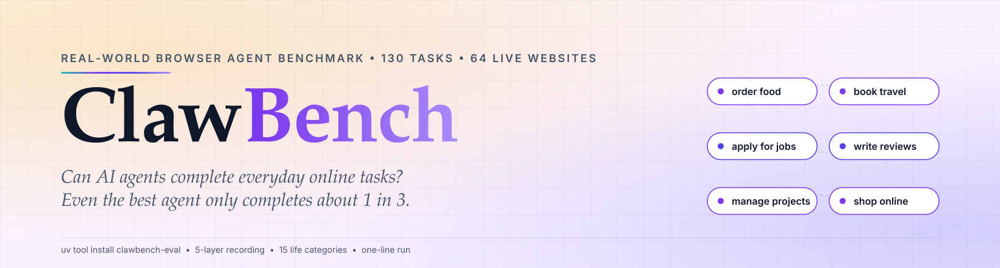
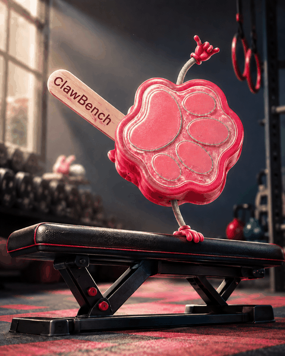
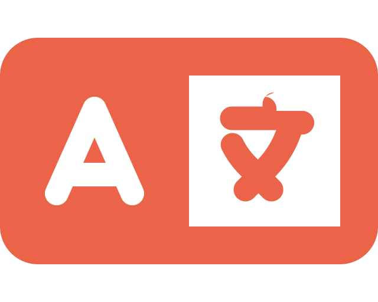
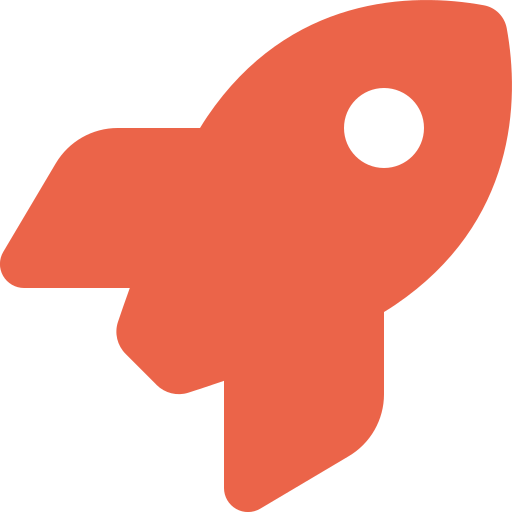
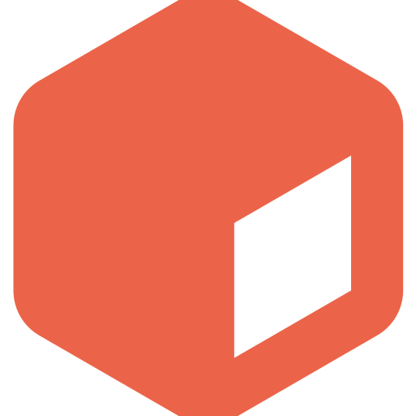
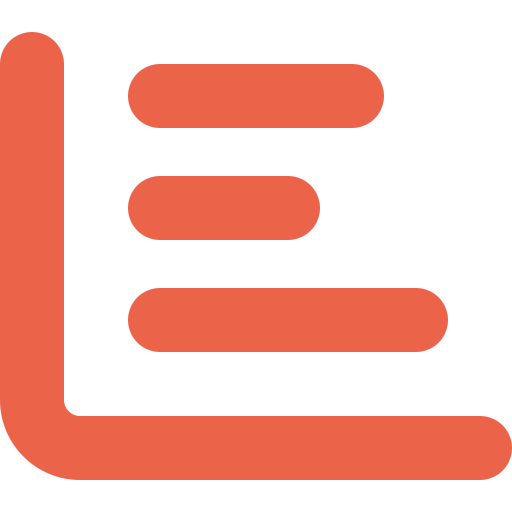
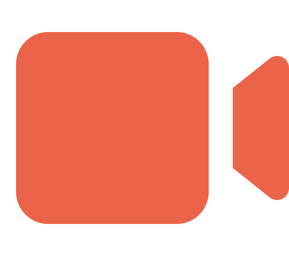
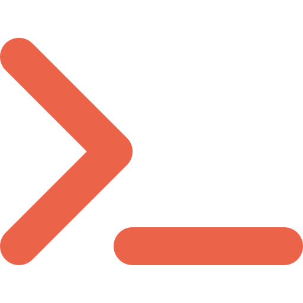

<div align="center">

<a href="https://github.com/TIGER-AI-Lab/ClawBench">
  <picture>
    <source media="(prefers-color-scheme: dark)" srcset="assets/hero-dark.svg">
    
  </picture>
</a>

[](https://2026.emnlp.org/)
[](https://arxiv.org/abs/2604.08523)
[](https://huggingface.co/spaces/TIGER-Lab/ClawBench)
[](https://huggingface.co/datasets/NAIL-Group/ClawBench)
[](https://huggingface.co/datasets/TIGER-Lab/ClawBenchV2Trace)
[](https://claw-bench.com)
[](https://pypi.org/project/clawbench-eval/)
[](https://github.com/TIGER-AI-Lab/ClawBench/issues/new/choose)
[](https://github.com/TIGER-AI-Lab/ClawBench)

<a href="https://huggingface.co/papers/2604.08523"></a>
<a href="https://deepwiki.com/TIGER-AI-Lab/ClawBench"></a>

<details>
<summary><sub><i>More badges &middot; featured in 37 curated lists</i></sub></summary>
<p align="center">
  <a href="https://github.com/TIGER-AI-Lab/ClawBench/blob/main/LICENSE"></a>
  <a href="https://huggingface.co/datasets/NAIL-Group/ClawBenchV1Trace"></a>
  <a href="https://pypi.org/project/clawbench-eval/"></a>
  <a href="https://codespaces.new/TIGER-AI-Lab/ClawBench?quickstart=1"></a>
  <a href="https://github.com/TIGER-AI-Lab/ClawBench/commits/main"></a>
  <a href="https://github.com/TIGER-AI-Lab/ClawBench/graphs/contributors"></a>
  <a href="https://github.com/TIGER-AI-Lab/ClawBench/graphs/commit-activity"></a>
</p>
<p align="center">
  <a href="https://github.com/walkinglabs/awesome-harness-engineering"></a>
  <a href="https://github.com/Picrew/awesome-agent-harness"></a>
  <a href="https://github.com/OpenHands/open-operator"></a>
  <a href="https://github.com/Jenqyang/Awesome-AI-Agents"></a>
  <a href="https://github.com/ranpox/awesome-computer-use"></a>
  <a href="https://github.com/philfung/awesome-computer-use"></a>
  <a href="https://github.com/ZJU-REAL/Awesome-GUI-Agents"></a>
  <a href="https://github.com/OSU-NLP-Group/GUI-Agents-Paper-List"></a>
  <a href="https://github.com/zhangxjohn/LLM-Agent-Benchmark-List"></a>
  <a href="https://github.com/HHHHHejia/Awesome-AgenticLLM-RL-Papers"></a>
  <a href="https://github.com/RUC-NLPIR/Awesome-Long-Horizon-Agents"></a>
  <a href="https://github.com/Lhy723/awesome-ai-agent-evaluation"></a>
  <a href="https://github.com/MLGroupJLU/LLM-eval-survey"></a>
  <a href="https://github.com/SAILResearch/awesome-ai-leaderboard"></a>
  <a href="https://github.com/EthicalML/awesome-agentic-engineering-resources"></a>
  <a href="https://github.com/SafeRL-Lab/agentic-web"></a>
  <a href="https://github.com/VoltAgent/awesome-ai-agent-papers"></a>
  <a href="https://github.com/js-lee-AI/awesome-llm-agent-papers"></a>
  <a href="https://github.com/Yangyi-Chen/Multimodal-AND-Large-Language-Models"></a>
  <a href="https://github.com/cdxeve/awesome-computer-use-agents"></a>
  <a href="https://github.com/ishandutta2007/Awesome-AI-Benchmarking"></a>
  <a href="https://github.com/brandonhimpfen/awesome-ai-benchmarks-evaluation"></a>
  <a href="https://github.com/pauldebdeep9/awesome-agentic-evaluation"></a>
  <a href="https://github.com/skyming/awesome-ai-agent"></a>
  <a href="https://github.com/steel-dev/awesome-web-agents"></a>
  <a href="https://github.com/Xnhyacinth/Awesome-LLM-Long-Context-Modeling"></a>
  <a href="https://github.com/YintongHuo/awesome-agent-trajectory"></a>
  <a href="https://github.com/ARUNAGIRINATHAN-K/awesome-ai-agents-2026"></a>
  <a href="https://github.com/Steve2457/Awesome-RL-GUI-Agents"></a>
  <a href="https://github.com/aloth/awesome-ai-agents"></a>
  <a href="https://github.com/FrontisAI/Awesome-Self-Improving-Agents"></a>
  <a href="https://github.com/zjunlp/LLMAgentPapers"></a>
  <a href="https://github.com/M1n9X/llm_agents_devtools"></a>
  <a href="https://github.com/bojieli/ai-agent-book"></a>
  <a href="https://github.com/IcyFeather233/Awesome-LLM-Agent-Trajectory-Analysis"></a>
  <a href="https://github.com/h9-tec/llm-systems-engineering-roadmap"></a>
  <a href="https://github.com/Necolizer/awesome-rl-for-agents"></a>
</p>
</details>

</div>

# ClawBench: Can AI Agents Complete Everyday Online Tasks?

<div align="center">

**ClawBench is an open-source benchmark that evaluates AI browser agents on everyday online tasks — booking travel, ordering food, applying for jobs, managing email — across live websites. V1 lives in `test-cases/v1/`, V2 in `test-cases/v2/`. It records five layers of evidence and supports request-based scoring and trajectory evaluation against human references. See the [live leaderboard](https://huggingface.co/spaces/TIGER-Lab/ClawBench) for scores by corpus, harness, and scoring rubric.**



We asked frontier AI agents to do what people do every day --<br/>
order food, book travel, apply for jobs, write reviews, manage projects.<br/>
**In the historical V1 paper evaluation, the strongest evaluated agent completed about 1 in 3 tasks.**

---

**V1: 152** everyday tasks &middot; **143** live sites &nbsp;&nbsp;|&nbsp;&nbsp; **V2: 129** tasks &middot; **63** live sites &nbsp;&nbsp;|&nbsp;&nbsp; **281 total** across **163** live websites &middot; **15** life categories

<sub><i>The paper reports 153 (V1) and 130 (V2); two ASPCA tasks were removed after publication, so the shipping corpus is 152 and 129.</i></sub>

<sub><i>Built by NAIL Group &nbsp;·&nbsp; Sister project: <a href="https://github.com/reacher-z/HarnessBench">HarnessBench</a> — fixes the base model, varies the harness &nbsp;·&nbsp; Runs on any Chrome.</i></sub>

<a href="docs/README.zh-CN.md"> 中文</a>

</div>

<a id="what-are-you-looking-for"></a>

##  What are you looking for?

| I want to… | Start here |
| --- | --- |
| Run my model | [Quick start](#quick-start) |
| See scores | [Live leaderboard](https://huggingface.co/spaces/TIGER-Lab/ClawBench) · [Results](#results) |
| Browse the tasks | [Task explorer](https://claw-bench.com/tasks) · [Datasets](#datasets) |
| Reproduce a score | [Reproduction workflow](#reproduce-the-leaderboard) · [Trace cookbook](docs/trace-cookbook.md) |
| Understand the benchmark | [Paper](https://arxiv.org/abs/2604.08523) · [FAQ](docs/faq.md) |
| Change the framework or add tasks | [Source layout](src/README.md) · [Contributing](CONTRIBUTING.md) |

All guides and integrations: **[Documentation index](docs/README.md)**.

<a id="quick-start"></a>
<a id="-human-quick-start"></a>
<a id="human-quick-start"></a>

##  Quick start

**Prerequisites:** Python 3.11+, [uv](https://docs.astral.sh/uv/), and a running
Docker or Podman engine. See [platform setup](docs/getting-started.md#prerequisites).

<a id="install"></a>

### Installed package

```bash
uv tool install clawbench-eval
clawbench
```

Launch from the directory where you want your configuration and results.
The interactive TUI guides you through adding a model and selecting a task.
Configure the default judge, `deepseek-v4-pro`, as well; the
[model setup guide](docs/getting-started.md#configure-models) explains judge
selection and how to run without scoring.

### Source checkout

```bash
git clone https://github.com/TIGER-AI-Lab/ClawBench.git
cd ClawBench
cp models/models.example.yaml models/models.yaml
# Edit models/models.yaml with your model and judge API settings.
uv run clawbench
```

`./run.sh` is a shortcut for the same TUI. For a non-interactive run from the
checkout:

```bash
uv run clawbench-run test-cases/v1/886-entertainment-hobbies-experience-topgolf your-provider-model-id
```

Replace `your-provider-model-id` with a configured model key. The first run
builds container images; the local browser's printed noVNC URL lets you watch
the agent. Recordings and metadata land under `test-output/`.

<a id="1-configure-models"></a>
<a id="2-run-your-first-task"></a>
<a id="3-pick-a-harness"></a>
<a id="4-other-browser-runtimes-and-frameworks"></a>

Continue with the **[getting started guide](docs/getting-started.md)** for
batch and human runs, [harness selection](docs/getting-started.md#choose-a-harness),
and remote browser options. The **[CLI reference](docs/cli.md)** covers
non-interactive commands. Coding agents can start with [`AGENTS.md`](AGENTS.md).

##  How it works

```
   You pick a task            ClawBench spins up           Agent drives the         Interceptor captures
   from V1 or V2              an isolated Docker           browser: navigates,      every action across
   everyday scenarios         container + Chromium         fills forms, clicks      all 5 layers of data

   ┌──────────────┐           ┌──────────────┐           ┌──────────────┐           ┌──────────────┐
   │  "Book a pet │    ──►    │   Container  │    ──►    │   AI Agent   │    ──►    │   5 layers   │
   │   sitter on  │           │  + Chromium  │           │  browses the │           │  intercepted │
   │   Rover"     │           │  + Agent     │           │   live site  │           │  & recorded  │
   └──────────────┘           └──────────────┘           └──────────────┘           └──────────────┘
```

<p align="center">
&nbsp;<b>Live Websites</b>
&nbsp;&nbsp;&nbsp;&nbsp;&nbsp;&nbsp;
&nbsp;<b>Isolated Containers</b>
&nbsp;&nbsp;&nbsp;&nbsp;&nbsp;&nbsp;
&nbsp;<b>Request Interceptor</b>
&nbsp;&nbsp;&nbsp;&nbsp;&nbsp;&nbsp;
&nbsp;<b>Five-Layer Recording</b>
</p>

<details>
<summary><b>Container internals</b></summary>

```
┌─────────────────────────────────────────────────┐
│  Container (Docker / Podman)                    │
│                                                 │
│  ┌──────────┐  CDP Fetch/Runtime/Page events    │
│  │ Chromium ├─────────────────────────────┐     │
│  │ :9222 CDP│                             │     │
│  └──────────┘                             │     │
│                                           │     │
│  ┌──────────┐            ┌────────────────▼─┐   │
│  │  Xvfb    │◄──ffmpeg──►│  FastAPI Server  │   │
│  │ :99      │  x11grab   │  :7878           │   │
│  └──────────┘            └──────────────────┘   │
│                                  │              │
│                          ┌───────▼─────────┐    │
│                          │     /data       │    │
│                          │  actions.jsonl  │    │
│                          │  requests.jsonl │    │
│                          │  screenshots/   │    │
│                          │  recording.mp4  │    │
│                          └─────────────────┘    │
└─────────────────────────────────────────────────┘
```

</details>

<a id="datasets"></a>

##  Datasets

ClawBench ships **three** Hugging Face datasets — task definitions plus full execution traces for V1 and V2. All open, downloadable in one command.

| Dataset | What's in it | Get it |
| --- | --- | --- |
| **[NAIL-Group/ClawBench](https://huggingface.co/datasets/NAIL-Group/ClawBench)** _(mirrored at [TIGER-Lab/ClawBench](https://huggingface.co/datasets/TIGER-Lab/ClawBench))_ | Task definitions, rubrics, and metadata for V1 and V2 — what to attempt and how it's judged. | `hf download --repo-type dataset NAIL-Group/ClawBench` |
| **[NAIL-Group/ClawBenchV1Trace](https://huggingface.co/datasets/NAIL-Group/ClawBenchV1Trace)** | One directory per V1 model run: `recording.mp4`, `requests.jsonl`, `actions.jsonl`, `agent-messages.jsonl`, `interception.json`, `run-meta.json`. | `hf download --repo-type dataset NAIL-Group/ClawBenchV1Trace` |
| **[TIGER-Lab/ClawBenchV2Trace](https://huggingface.co/datasets/TIGER-Lab/ClawBenchV2Trace)** | Same 5-layer bundle for **V2** runs. Rolling — new models added as they're evaluated. | `hf download --repo-type dataset TIGER-Lab/ClawBenchV2Trace` |

> **Build with the traces:** See the [Trace Cookbook](docs/trace-cookbook.md) for download recipes, data schemas, and research directions.

> The trace datasets are large; use `hf download --include "<pattern>"` to pull a single model or a single task.

> **🏆 Live leaderboard:** [`claw-bench.com/leaderboard`](https://claw-bench.com/leaderboard) (V2 default, two-stage scoring — interception + LLM judge). Full scoring formula in [`eval/scoring.md`](eval/scoring.md). Add your run: PR to [`leaderboard/results.csv`](https://huggingface.co/datasets/TIGER-Lab/ClawBench/blob/main/leaderboard/results.csv).

##  News

- **[2026.10.10]** — 🎉 ClawBench has surpassed **[1,000 GitHub stars](https://github.com/TIGER-AI-Lab/ClawBench/stargazers)**! Thank you to everyone who has starred, used, and contributed to the benchmark.
- **[2026.08.20]** — 🏆 Our paper has been accepted to [EMNLP 2026 Findings](https://2026.emnlp.org/).
- **[2026.08.20]** - Added [Kernel](https://www.kernel.sh) as a supported remote browser runtime. Thanks to @[rgarcia](https://github.com/rgarcia).
- **[2026.08.18]** — Added [WebBrain](https://github.com/webbrain-one/webbrain) as a supported harness. Thanks to @[alectimison-maker](https://github.com/alectimison-maker).
- **[2026.08.16]** — Released **[RewardHarness](https://github.com/TIGER-AI-Lab/RewardHarness)**, our self-evolving agentic reward framework: 47.4% on EditReward-Bench from just 100 preference demos, with no reward-model training. [Details →](https://arxiv.org/abs/2605.08703)
- **[2026.08.03]** — Added [Browserbase](https://www.browserbase.com) as a remote browser runtime. [Details →](docs/browser-runtimes.md)
- **[2026.07.30]** — v0.8.0: Gemini-as-judge, random-click baseline harness, EdgeBench/SForge adapter, remote-browser CDP support. [Details →](CHANGELOG.md)
- **[2026.07.25]** — 🏆 Our paper has been accepted by [COLM 2026 WAB](https://www.aiagentbehavior.com/).

<sub>Earlier updates: [`docs/news.md`](docs/news.md) &middot; full change history: [`CHANGELOG.md`](CHANGELOG.md)</sub>

## <a id="awesome-works-using-clawbench"></a>✨ Awesome Works using ClawBench

**Authors from Google DeepMind, Stanford, UC Berkeley, Google, Microsoft Research, Harvard, ETH Zürich, Oxford, Northwestern, ByteDance Seed, and HKUST build on ClawBench** — and Li Auto's Mach-Mind-4-Flash technical report evaluates on it.

😊 **Google DeepMind, University of Oxford & Columbia University**, [The Recipe for Intelligence in Natural and Artificial Systems](https://osf.io/preprints/psyarxiv/x9ktv_v1/) ([DOI](https://doi.org/10.31234/osf.io/x9ktv_v1))

😊 **Stanford, UC Berkeley, Microsoft Research & UCSB**, [Auditing Agent Harness Safety](https://arxiv.org/abs/2605.14271) ([Code](https://github.com/UCSB-AI/HarnessAudit), [Project](https://harnessaudit.github.io/))

😊 **Google**, [Agentic Coding Needs Proactivity, Not Just Autonomy](https://arxiv.org/abs/2605.06717) ([Google Research Blog](https://developers.googleblog.com/en/measuring-what-matters-with-jules/))

😊 **Harvard Kempner Institute, Massachusetts General Hospital & CUHK**, [NeuroClaw Technical Report](https://arxiv.org/abs/2604.24696) ([Code](https://github.com/CUHK-AIM-Group/NeuroClaw), [Project](https://cuhk-aim-group.github.io/NeuroClaw/))

😊 **ETH Zürich & Handshake AI Research**, [Verifying Agents in Rubric-Graded Environments](https://openreview.net/pdf?id=ayA2tJNDET) ([Code](https://github.com/Handshake-AI-Research/gandalf-the-grader), [Workshop](https://rl-eval.github.io/))

😊 **University of Oxford, NUS & Peking University**, [OpenClaw Research: A Systematic Survey of Large Language Model Agents in Open Deployment](https://openreview.net/forum?id=5PMzjzEy6J) ([Project](https://ykc1.github.io/OpenClaw_Survey_Web/), [Resources](https://github.com/shuolucs/Awesome-OpenClaw-Research))

😊 **Northwestern University**, [A Survey of the OpenClaw Ecosystem: From Platform Extensibility to Constraint Design](https://openreview.net/pdf/eab5a52b7bba57e22707282587f78e482b44d9b0.pdf) ([Project & Resources](https://github.com/REAL-Lab-NU/Awesome-OpenClaw-Papers))

😊 **UC Davis & UT Dallas**, [Toward Trustworthy Computer-Use Agents: Risk Propagation, Evaluation Gaps, and Human Governance](https://www.researchgate.net/publication/405422774_Toward_Trustworthy_Computer-Use_Agents_Risk_Propagation_Evaluation_Gaps_and_Human_Governance) ([Code & Project](https://github.com/xu-hu-2002/Toward-Trustworthy-Computer-Use-Agent-A-Survey), [Resources](https://huggingface.co/datasets/Xu-Hu-2002/Toward-Thustworthy-Computer-Use-Agent))

<details>
<summary><b>9 more works</b></summary>

😊 **ByteDance Seed & HKUST**, [Training Long-Context Vision-Language Models Effectively with Generalization Beyond 128K Context](https://arxiv.org/abs/2605.13831) ([Models](https://huggingface.co/collections/ZhaoweiWang/mmprolong))

😊 **Tencent Hunyuan & Fudan University**, [TurnOPD: Making On-Policy Distillation Turn-Aware for Efficient Long-Horizon Agent Training](https://arxiv.org/abs/2607.05804)

😊 **Unipat AI**, [VibeSearchBench: Benchmarking Long-horizon Proactive Search in the Wild](https://arxiv.org/abs/2605.27882) ([Code](https://github.com/VibeBench/VibeSearchBench), [Project](https://vibebench.github.io/VibeSearchBench.github.io/))

😊 **Tsinghua University & CUHK**, [WildClawBench: A Benchmark for Real-World, Long-Horizon Agent Evaluation](https://arxiv.org/abs/2605.10912) ([Code](https://github.com/InternLM/WildClawBench), [Project](https://internlm.github.io/WildClawBench/))

😊 **NUS, HKUST, Tsinghua University & Peking University**, [Towards Long-Horizon Agents: A Survey](https://openreview.net/forum?id=HyhfhlbWGh) ([Project](https://long-horizon-agents.github.io/), [Resources](https://github.com/RUC-NLPIR/Awesome-Long-Horizon-Agents))

😊 **HKU MMLab**, [UniClawBench: A Universal Benchmark for Proactive Agents on Real-World Tasks](https://arxiv.org/abs/2607.08768) ([Code](https://github.com/HKU-MMLab/UniClawBench), [Project](https://uniclawbench.github.io/))

😊 **Tsinghua University & SJTU**, [MacAgentBench: Benchmarking AI Agents on Real-World macOS Desktop](https://arxiv.org/abs/2606.22557) ([Code](https://github.com/JetAstra/MacAgentBench), [Project](https://jetastra.github.io/MacAgentBench/))

😊 **Peking University & CUHK**, [π-Bench: Evaluating Proactive Personal Assistant Agents in Long-Horizon Workflows](https://arxiv.org/abs/2605.14678) ([Code](https://github.com/Simplified-Reasoning/Pi-Bench), [Project](https://simplified-reasoning.github.io/Pi-Bench/))

😊 **SJTU**, [AcademiClaw: When Students Set Challenges for AI Agents](https://arxiv.org/abs/2605.02661) ([Code](https://github.com/GAIR-NLP/AcademiClaw), [Project](https://gair-nlp.github.io/AcademiClaw/))

</details>

If we missed your work, please [open an issue](https://github.com/TIGER-AI-Lab/ClawBench/issues/new/choose) or submit a pull request.

<a id="results"></a>

##  Results

<div align="center">

**ClawBench leaderboard** &nbsp;&middot;&nbsp; by corpus × harness &nbsp;&middot;&nbsp; live at [claw-bench.com](https://claw-bench.com/)

</div>

<details open>
<summary><b>V2 (Hermes)</b> &nbsp;·&nbsp; 8 models &nbsp;·&nbsp; ds-v4-pro judge, lenient + strict</summary>

| Rank  | Model                  | Harness | Intercepted | Reward (lenient) | Reward (strict) | Pass / Total |
| :---: | ---------------------- | ------- | ----------: | ---------------: | --------------: | -----------: |
|   1   | **claude-opus-4-7**    | hermes  |   **54.6%** |        **44.6%** |           24.6% |     58 / 130 |
|   2   | gpt-5.5                | hermes  |       45.4% |            35.4% |           18.5% |     46 / 130 |
|   3   | glm-5.1                | hermes  |       48.5% |            34.6% |           17.7% |     45 / 130 |
|   4   | deepseek-v4-pro        | hermes  |       43.9% |            33.9% |           12.3% |     44 / 130 |
|   5   | openrouter-owl-alpha   | hermes  |       14.6% |             0.0% |            0.0% |      0 / 130 |
|   6   | z-ai/glm-4.5-air:free  | hermes  |        4.6% |             2.3% |            0.8% |      3 / 130 |
|   7   | deepseek-v4-flash:free | hermes  |        3.1% |             2.3% |            0.0% |      3 / 129 |
|   8   | minimax-m2.5:free      | hermes  |        2.3% |             1.5% |            0.0% |      2 / 130 |

**Intercepted** = final HTTP request matched the task's URL/method (Stage 1, deterministic). **Reward (lenient)** = additionally judged by `deepseek/deepseek-v4-pro` to fulfill the instruction under the "no contradiction → match" rubric (Stage 2). **Reward (strict)** = same judge, strict rubric ("ambiguous → mismatch"). Ranked by Intercepted; Reward as tiebreak. Totals reflect the corpus size at run time.

</details>

<details>
<summary><b>V2 (OpenClaw)</b> &nbsp;·&nbsp; 1 model</summary>

| Rank  | Model   | Harness  | Intercepted | Reward (lenient) | Reward (strict) | Pass / Total |
| :---: | ------- | -------- | ----------: | ---------------: | --------------: | -----------: |
|   1   | glm-5.1 | openclaw |        0.0% |             0.0% |            0.0% |      0 / 130 |

</details>

<details>
<summary><b>V1 (Hermes)</b> &nbsp;·&nbsp; 6 frontier models, original paper rubric</summary>

| Rank  | Model                     | Harness | Pass Rate | Pass / Total |
| :---: | ------------------------- | ------- | --------: | -----------: |
|   1   | claude-opus-4-6           | hermes  |     61.4% |     94 / 153 |
|   2   | claude-sonnet-4-6         | hermes  |     56.9% |     87 / 153 |
|   3   | claude-haiku-4-5-20251001 | hermes  |     30.1% |     46 / 153 |
|   4   | gpt-5.4-2026-03-05        | hermes  |     25.5% |     39 / 153 |
|   5   | gpt-5.4-mini-2026-03-17   | hermes  |     24.8% |     38 / 153 |
|   6   | kimi-k2.5                 | hermes  |     17.6% |     27 / 153 |

V1 Pass Rate is from the original paper rubric (Claude Code agentic-eval subagent comparing each run against human reference trajectories under `eval/agentic_eval.md`). The two-stage Reward (interception + `deepseek/deepseek-v4-pro` lenient judge) for V1 will appear here once V1 trace bundles are re-judged.

<details>
<summary>V1 per-category breakdown (Sonnet 4.6 vs 6-model comparison)</summary>

| Rank  | Model                 | Overall  |  Daily   | Finance  |   Work   |   Dev    | Academic |  Travel  |  Social  |   Pets   |
| :---: | --------------------- | :------: | :------: | :------: | :------: | :------: | :------: | :------: | :------: | :------: |
|   1   | **Claude Sonnet 4.6** | **33.3** |   44.2   | **50.0** |   19.0   |   11.1   | **50.0** |   23.1   | **38.9** | **18.2** |
|   2   | GLM-5                 |   24.2   | **30.8** |   16.7   | **38.1** |   16.7   |   28.6   |   0.0    |   16.7   | **18.2** |
|   3   | Gemini 3 Flash        |   19.0   |   15.4   |   33.3   |   23.8   | **22.2** |   28.6   | **30.8** |   11.1   |   0.0    |
|   4   | Claude Haiku 4.5      |   18.3   |   15.4   |   22.2   |   19.0   | **27.8** |   21.4   |   7.7    |   16.7   | **18.2** |
|   5   | GPT-5.4               |   6.5    |   9.6    |   0.0    |   0.0    |   11.1   |   7.1    |   7.7    |   0.0    |   9.1    |
|   6   | Gemini 3.1 Flash Lite |   3.3    |   1.9    |   0.0    |   0.0    |   5.6    |   14.3   |   0.0    |   0.0    |   9.1    |

</details>

</details>

<details>
<summary><b>Task categories</b> &nbsp;·&nbsp; V1: 15 categories, 152 tasks</summary>

| Category                  | Tasks | Example Platforms                                             |
| ------------------------- | :---: | ------------------------------------------------------------- |
| Daily Life                |  21   | Uber Eats, DoorDash, Instacart, Zillow, Craigslist            |
| Entertainment & Hobbies   |  15   | Ticketmaster, AMC Theatres, Topgolf, Crunchyroll              |
| Creation & Initialization |  13   | Squarespace, Wix, Webflow, Ghost, Substack                    |
| Rating & Voting           |  10   | Trustpilot, G2, Goodreads, RateMyProfessors                   |
| Travel                    |   9   | Booking.com, Expedia, Airbnb, TripAdvisor                     |
| Education & Learning      |   9   | Coursera, Udemy, Khan Academy, Duolingo                       |
| Office & Secretary        |   9   | Google Calendar, Slack, Notion, Trello                        |
| Beauty & Personal Care    |   9   | Sephora, Ulta, Glossier                                       |
| Job Search & HR           |   8   | LinkedIn, Greenhouse, Lever, Workday                          |
| Pet & Animal Care         |   7   | Chewy, Petco, Rover                                           |
| Personal Management       |   6   | Mint, YNAB, Todoist                                           |
| Shopping & Commerce       |   6   | Amazon, eBay, Etsy, Target                                    |
| Nonprofit & Charity       |   6   | GoFundMe, DonorsChoose                                        |
| Academia & Research       |   5   | Google Scholar, Semantic Scholar, OpenReview                  |
| Finance & Investment      |   4   | Robinhood, Fidelity, Coinbase                                 |
| Others                    |  15   | Automation, Dev & Tech, Government, Home Services, Automotive |

</details>

<sub>Codex and Claude Code runs on V2, and the V1 OpenClaw aggregate, are still in flight — they land on the [live leaderboard](https://claw-bench.com/leaderboard) first.</sub>

<a id="reproduce-the-leaderboard"></a>
<a id="-reproduce-the-leaderboard"></a>

##  Reproduce the leaderboard

> **Our scores are stable**: two independent runs of the same model under the same judge (`deepseek/deepseek-v4-pro`, lenient rubric) reproduce Intercepted and Reward within ±2 pp on the V2 corpus.

There are **two ways** to verify this on your own machine.

### Path A — Re-run the agent, then score

Confirms the *full pipeline* (your agent + our judge) lines up with our leaderboard row.

```bash
clawbench-batch --models deepseek/deepseek-v4-flash --cases-suite v2 \
  --all-cases --harness hermes --no-judge --output-dir ./my-run
clawbench-rescore ./my-run --judge-model deepseek-v4-pro --rubric both
```

### Path B — Skip the run, re-judge our published traces

Confirms *just the judge* matches ours (cheap, no agent compute, useful for sanity-checking your judge config).

```bash
hf download --repo-type dataset TIGER-Lab/ClawBenchV2Trace \
  --include "batch-aligned-*/deepseek-v4-flash-free/**" --local-dir ./reproduce
clawbench-rescore ./reproduce --judge-model deepseek-v4-pro --rubric both
```

One-shot equivalent of Path B for any model in the leaderboard:

```bash
clawbench-reproduce --model deepseek-v4-flash --tolerance 2.0
```

### Pass criterion

For `deepseek-v4-flash:free × hermes × v2`, the published row is **Intercepted 3.1% / Reward-lenient 2.3% / Reward-strict 0.0% (3 / 129)**. Path A or B counts as **reproduced** when all three metrics land within ±2 pp. Larger gaps usually mean a different judge model, a different rubric prompt, or a harness configuration drift — diff your `eval_results/<batch>/summary.json` against the published row to localize the cause.

##  ClawBench-Lite

**New here? Run this first.** [`test-cases/v1-lite/`](test-cases/v1-lite/) is a **20-task curated subset** of V1, selected for household-name sites, real-world relevance, difficulty, and category diversity. It matches the 20-tasks-per-source convention of [browser-use/benchmark](https://github.com/browser-use/benchmark) and gives you a credible signal at a fraction of the full-benchmark cost.

Tier distribution: **flagship 9 / core 8 / wildcard 3** — spanning daily life (OpenTable, DoorDash, Instacart, TaskRabbit), entertainment (Eventbrite, Goodreads, Fandango), creation (Asana, Mailchimp, Squarespace), travel (Airbnb), education (LeetCode), dev-tech (GitHub), academia (Overleaf), personal management (1Password), and more. Use the separate [human-reference evaluation workflow](eval/README.md) to evaluate Lite trajectories under [`eval/agentic_eval.md`](eval/agentic_eval.md); selecting the suite does not switch the native request judge to trajectory evaluation.

Run it with `--cases-suite v1-lite`, or inspect the link-backed task files in [`test-cases/v1-lite/`](test-cases/v1-lite/).

##  Example walkthrough

The [task walkthrough](docs/walkthrough.md) follows a V1 task from its JSON
specification through the recorded browser session and human-reference
assessment. It also explains why a placeholder interception rule needs
trajectory evaluation.

##  Evaluation

The native runner scores intercepted requests with an LLM judge by default:
a pass requires both an interception and a matching judge verdict.
`--no-judge` reports interception-only results; `clawbench-rescore` can judge
saved requests later. See the [CLI reference](docs/cli.md#clawbench-rescore).

The original V1 evaluation compares complete agent and human-reference
trajectories under [`eval/agentic_eval.md`](eval/agentic_eval.md). This is a
separate workflow described in the [evaluation guide](eval/README.md).
Compare scores using the same corpus revision, harness, and rubric.

To share rescored results, see the
[OpenEval / EvalPort export instructions](eval/README.md#export-results-to-openeval--evalport).

<a id="-cli"></a>

##  CLI

```bash
./run.sh                                                                   # interactive TUI
uv run clawbench-run <case-dir> <model>                                    # one task
uv run clawbench-run <case-dir> --human                                    # human reference run
uv run clawbench-batch --models <model> --cases-suite v2 --all-cases       # a whole corpus
```

Command overview and commonly used flags: **[CLI reference](docs/cli.md)**.
Run any command with `--help` for its complete option list.

V1 tasks are in [`test-cases/v1/`](test-cases/v1/) (152 tasks), V2 in `test-cases/v2/` (129), Lite in `test-cases/v1-lite/` (20), and converted Claw-Eval tasks in `test-cases/claw-eval/` (19). All suites use [`test-cases/task.schema.json`](test-cases/task.schema.json). For test case authoring, see [CONTRIBUTING.md](CONTRIBUTING.md); for output structure and evaluation guidance, see [`eval/README.md`](eval/README.md).

## How ClawBench compares

| Benchmark                                                           | Domain               | Environment               | Task count | ClawBench difference                                                         |
| ------------------------------------------------------------------- | -------------------- | ------------------------- | ---------- | ---------------------------------------------------------------------------- |
| [WebArena](https://webarena.dev)                                    | Synthetic web apps   | Self-hosted replicas      | 812        | Live consumer sites, not admin UIs on hosted replicas                        |
| [GAIA](https://huggingface.co/datasets/gaia-benchmark/GAIA)         | General assistants   | Closed-book text + tools  | 466        | Browser-centric; end-to-end task execution                                   |
| [SWE-bench](https://www.swebench.com)                               | Software engineering | GitHub repos              | 2,294      | Non-code; everyday consumer workflows                                        |
| [BrowserGym](https://github.com/ServiceNow/BrowserGym)              | Web agents           | Headless sandbox          | —          | Cloud-parity; records real user journeys                                     |
| [Mind2Web](https://github.com/OSU-NLP-Group/Mind2Web)               | Web navigation       | Static traces             | 2,350      | Dynamic live websites, not replayed traces                                   |
| [Online-Mind2Web](https://github.com/OSU-NLP-Group/Online-Mind2Web) | Live web navigation  | Real websites             | 300        | V1+V2: 281 tasks, with full five-layer recordings |
| [VisualWebArena](https://jykoh.com/vwa)                             | Visual web tasks     | Self-hosted (3 sites)     | 910        | Real websites with full visual layer (vs 3 hosted apps)                      |
| [WebVoyager](https://github.com/MinorJerry/WebVoyager)              | Real-website nav     | Real websites (15)        | 643        | Interception-graded vs LLM-judge-only, 143 sites covered                     |
| [TheAgentCompany](https://the-agent-company.com)                    | Office workflows     | Self-hosted (6 platforms) | 175        | Consumer everyday tasks instead of enterprise sandbox                        |

ClawBench's niche: **live consumer websites, everyday tasks, end-to-end recording**. If you want a controlled sandbox or replayed traces, the projects above are excellent. If you want to know whether your agent can actually order food or book a flight *today*, this is the benchmark for that.

<a id="faq"></a>
<a id="frequently-asked-questions"></a>

##  FAQ

<a id="what-it-is"></a>
<a id="running-it"></a>
<a id="scoring-and-safety"></a>
<a id="contributing-and-coverage"></a>

See the **[FAQ](docs/faq.md)** for task coverage, account setup, recording
artifacts, scoring, and live-site limitations. For installation and model
configuration, use [Getting started](docs/getting-started.md).

## Contributing

We welcome contributions -- especially new test cases. If you've ever ordered groceries, booked an appointment, or filed a form online, you already know how to write one. Most PRs are a single JSON file and land in under a day.

**Quick wins:**

- [Add a new test case](CONTRIBUTING.md#adding-a-new-test-case) (~30 min, no container expertise needed)
- [Add a new category](CONTRIBUTING.md#what-were-looking-for) of 10+ tasks &rarr; co-author invitation on the next paper revision
- [Submit a new model](CONTRIBUTING.md#what-were-looking-for) to the public leaderboard
- Browse [good first issues](https://github.com/TIGER-AI-Lab/ClawBench/labels/good%20first%20issue)

See [CONTRIBUTING.md](CONTRIBUTING.md) for the full guide and contributor recognition policy.

## Community

Come hang out with researchers, builders, and contributors working on real-world browser agents.

<table>
<tr>
<td align="center" width="33%">
<a href="https://github.com/TIGER-AI-Lab/ClawBench/issues/new/choose">

</a>
<br/>
<sub><b>Questions &amp; bugs</b><br/>Fastest route to a maintainer</sub>
</td>
<td align="center" width="33%">
<a href="assets/community/wechat_grp_422.jpg">

</a>
<br/>
<sub><b>中文社区</b><br/>研究者、开发者、贡献者交流</sub>
</td>
<td align="center" width="33%">
<a href="https://huggingface.co/datasets/NAIL-Group/ClawBench/discussions">

</a>
<br/>
<sub><b>Dataset &amp; leaderboard talk</b><br/>On the Hub, next to the data</sub>
</td>
</tr>
</table>

## Citation

If you use ClawBench in your research, please cite:

```bibtex
@misc{zhang2026clawbenchaiagentscomplete,
  title         = {ClawBench: Can AI Agents Complete Everyday Online Tasks?},
  author        = {Yuxuan Zhang and Yubo Wang and Yipeng Zhu and Penghui Du and Junwen Miao and Xuan Lu and Wendong Xu and Yunzhuo Hao and Songcheng Cai and Xiaochen Wang and Huaisong Zhang and Xian Wu and Yi Lu and Minyi Lei and Kai Zou and Huifeng Yin and Ping Nie and Liang Chen and Dongfu Jiang and Wenhu Chen and Kelsey R. Allen},
  year          = {2026},
  eprint        = {2604.08523},
  archivePrefix = {arXiv},
  primaryClass  = {cs.CL},
  url           = {https://arxiv.org/abs/2604.08523}
}
```

## Contact

Questions, suggestions, or research collaboration? Reach the maintainer:

- **Yuxuan Zhang** &mdash; `reacher` &lbrack;at&rbrack; `cs.ubc.ca` (UBC, NAIL Group) &middot; [Homepage &#8599;](https://reacher-z.github.io)
- For bug reports or feature requests, please [open a GitHub issue](https://github.com/TIGER-AI-Lab/ClawBench/issues/new/choose) &mdash; it's faster than email and gets seen by all maintainers.

## Core Contributors

<table>
<tr>
<td align="center">
<a href="https://github.com/reacher-z">
<br/>
<sub><b>Yuxuan Zhang</b></sub>
</a>
</td>
<td align="center">
<a href="https://github.com/Wyyyb">
<br/>
<sub><b>Yubo Wang</b></sub>
</a>
</td>
<td align="center">
<a href="https://github.com/Perry2004">
<br/>
<sub><b>Perry Zhu</b></sub>
</a>
</td>
<td align="center">
<a href="https://github.com/eternaldolphin">
<br/>
<sub><b>Penghui Du</b></sub>
</a>
</td>
<td align="center">
<a href="https://github.com/MEKSAAA">
<br/>
<sub><b>Junwen Miao</b></sub>
</a>
</td>
</tr>
</table>

## Advisors

<table>
<tr>
<td align="center">
<a href="https://github.com/k-r-allen">
<br/>
<sub><b>Kelsey R. Allen</b></sub>
</a>
</td>
<td align="center">
<a href="https://github.com/wenhuchen">
<br/>
<sub><b>Wenhu Chen</b></sub>
</a>
</td>
<td align="center">
<a href="https://github.com/jdf-prog">
<br/>
<sub><b>Dongfu Jiang</b></sub>
</a>
</td>
<td align="center">
<a href="https://github.com/chenllliang">
<br/>
<sub><b>Liang Chen</b></sub>
</a>
</td>
</tr>
</table>

## Support ClawBench

If ClawBench is useful for your research or product work, the single most helpful thing you can do is **[star the repo](https://github.com/TIGER-AI-Lab/ClawBench)** — it surfaces the benchmark to other AI-agent researchers and helps us justify continued dataset curation.

<p align="center">
<a href="https://github.com/TIGER-AI-Lab/ClawBench">

</a>
</p>

Open to contributions — new test cases, bug fixes, or evaluation submissions for a model we haven't scored yet. See [`CONTRIBUTING.md`](CONTRIBUTING.md).

<p align="center">
<a href="https://github.com/TIGER-AI-Lab/ClawBench/graphs/contributors">

</a>
</p>

## Star History

<a href="https://www.star-history.com/?type=date&repos=TIGER-AI-Lab%2FClawBench">
 <picture>
   <source media="(prefers-color-scheme: dark)" srcset="https://api.star-history.com/chart?repos=TIGER-AI-Lab/ClawBench&type=date&theme=dark&legend=top-left&sealed_token=TZeXwgvoa-F4OXufUJG_yeQiaNJ3qK5xGDCyv4iJiF1UvtEWAfS4a3mN5_3tsdq8V-YHSGS6kjAsDJoAScK6tTCEqNl5hYsfec3LzAqQWDG2lNkdmTkIlg" />
   <source media="(prefers-color-scheme: light)" srcset="https://api.star-history.com/chart?repos=TIGER-AI-Lab/ClawBench&type=date&legend=top-left&sealed_token=TZeXwgvoa-F4OXufUJG_yeQiaNJ3qK5xGDCyv4iJiF1UvtEWAfS4a3mN5_3tsdq8V-YHSGS6kjAsDJoAScK6tTCEqNl5hYsfec3LzAqQWDG2lNkdmTkIlg" />
   
 </picture>
</a>

## License & Acknowledgments

Apache 2.0 -- see [LICENSE](LICENSE).

The converted Claw-Eval suite in [`test-cases/claw-eval/`](test-cases/claw-eval/) is derived from [claw-eval/claw-eval](https://github.com/claw-eval/claw-eval) and the [claw-eval/Claw-Eval](https://huggingface.co/datasets/claw-eval/Claw-Eval) dataset, which are released under the MIT License. Third-party package notices are in [NOTICE](NOTICE).

Built with [OpenClaw](https://github.com/openclaw/openclaw), [opencode](https://opencode.ai), [Claude Code](https://docs.anthropic.com/en/docs/claude-code), the [Claude in Chrome](https://code.claude.com/docs/en/chrome) extension, [OpenAI Codex CLI](https://github.com/openai/codex), [browser-use](https://github.com/browser-use/browser-use), [claw-code](https://github.com/ultraworkers/claw-code), [Hermes Agent](https://github.com/NousResearch/hermes-agent), [Pi](https://pi.dev/) with [pi-browser-harness](https://pi.dev/packages/pi-browser-harness), and [WebBrain](https://github.com/webbrain-one/webbrain) (selectable harnesses), [Microsoft Playwright MCP](https://github.com/microsoft/playwright-mcp) (browser control bridge for the opencode, claude-code, codex, and claw-code harnesses), [LiteLLM](https://github.com/BerriAI/litellm) (API translation proxy for the claude-code, claude-code-chrome-extension, codex, browser-use, claw-code, and pi harnesses), [noVNC](https://github.com/novnc/noVNC) (MPL 2.0), and [websockify](https://github.com/novnc/websockify) (LGPL 3.0).
