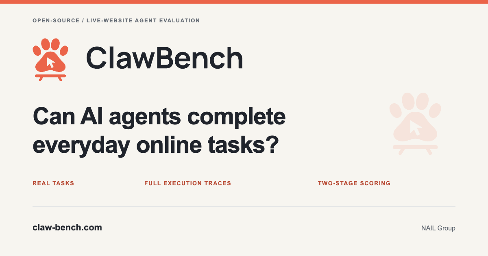

# ClawBench visual identity

The mark combines a paw, a mouse-pointer cutout, and a bench. The coral mark works on light and dark backgrounds; the wordmark has separate light and dark versions.

| Asset | Use |
| --- | --- |
| [clawbench-logo.svg](../clawbench-logo.svg) | Horizontal logo on light backgrounds |
| [clawbench-logo-dark.svg](../clawbench-logo-dark.svg) | Horizontal logo on dark backgrounds |
| [clawbench-mark.svg](../clawbench-mark.svg) | Standalone icon or avatar |
| [clawbench-logo-mono.svg](../clawbench-logo-mono.svg) · [mark](../clawbench-mark-mono.svg) | One-color print, papers, and light backgrounds |
| [clawbench-logo-white.svg](../clawbench-logo-white.svg) · [mark](../clawbench-mark-white.svg) | Reversed logo on dark backgrounds |
| [favicon.svg](../favicon.svg) · [16 px](../favicon-16.png) · [32 px](../favicon-32.png) · [ICO](../favicon.ico) | Simplified small icon; ICO includes 16/32/48/64 px sizes |
| [social-card.svg](../social-card.svg) · [PNG](../social-card.png) | 1200 × 630 social preview for GitHub, the website, and project announcements |

The logo and mark variants are transparent SVGs, with lettering stored as paths. Use the horizontal logo at 160 px or wider and the regular mark at 32 px or larger. For 16–32 px placements, use the simplified favicon, which has a wider cursor cutout and a solid coral tile. Leave at least one toe's width of clear space around the regular logo; preserve its aspect ratio.

Use the black version in monochrome papers and the white version on dark slides. Use the PNG social card when a platform requires a bitmap; its SVG is the editable source. Website metadata can reference the favicon and social card. The existing [Hugging Face metadata example](../../docs/huggingface-space-metadata.md) already uses `assets/social-card.png`.



Colors: coral `#EB6449`, ink `#20242C`, ivory `#F3F1ED`. The README uses a darker coral `#B84A34` behind white badge lettering.

The wordmark uses outlined [Manrope](https://github.com/googlefonts/manrope), weight 720, with optical spacing and kerning. Its [SIL Open Font License](Manrope-OFL.txt) is included here.

The README heading icons share the coral accent. Workflow illustrations have English and Chinese text, wide and narrow layouts, and light and dark variants. The narrow version uses larger lettering and a fixed intrinsic width so GitHub's sidebar does not shrink the four-column diagram into unreadable text.

Edit [generate_workflow.py](generate_workflow.py) to change labels, colors, or geometry. Regenerate all eight variants with no extra dependencies:

```bash
python3 assets/brand/generate_workflow.py
python3 assets/brand/generate_workflow.py --check
```

The [brand generator](generate_assets.py) derives the monochrome variants and social card from the primary SVG logo, and owns the small-icon geometry. Generate vector assets with the standard library:

```bash
python3 assets/brand/generate_assets.py
```

To update the PNG/ICO exports, install Playwright's Chromium or pass `--browser-executable /path/to/chrome`:

```bash
uv run --no-project --with playwright --with pillow python -m playwright install chromium
uv run --no-project --with playwright --with pillow python assets/brand/generate_assets.py --render
python3 assets/brand/generate_assets.py --check
```

The [raster manifest](raster-sources.json) links each PNG/ICO export to its SVG source hash. CI checks the generated vectors and those hashes to catch stale exports. The social card uses Arial/Helvetica for editable supporting text; use the committed PNG for consistent sharing across platforms.
