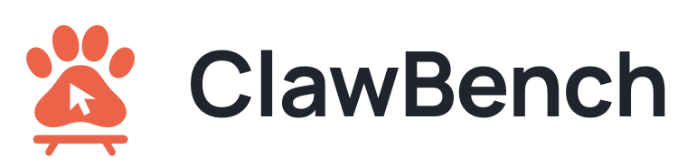
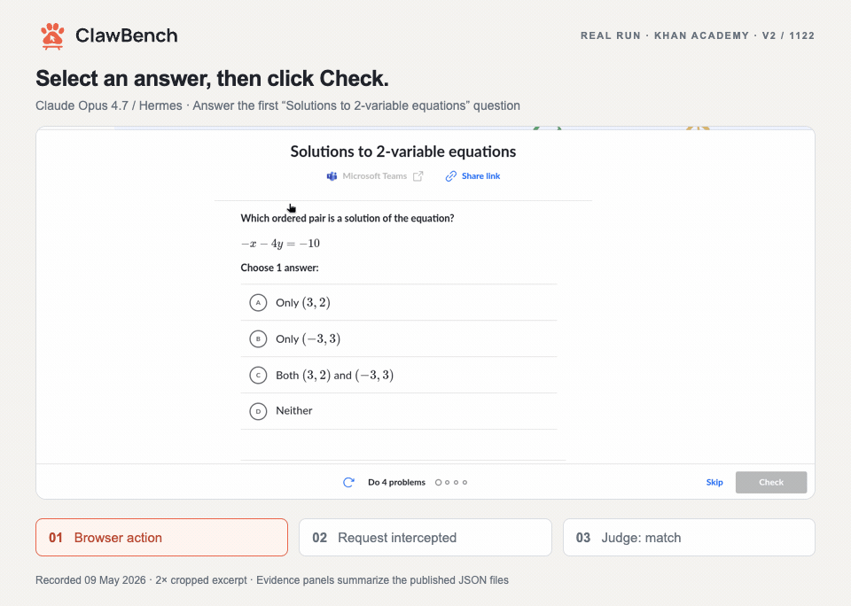
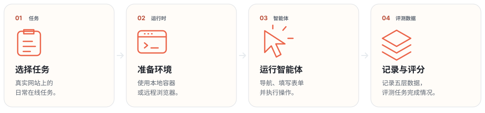

<p align="center">
  <a href="https://github.com/TIGER-AI-Lab/ClawBench">
    <picture>
      <source media="(prefers-color-scheme: dark)" srcset="../assets/clawbench-logo-dark.svg">
      
    </picture>
  </a>
</p>

<h1 align="center">AI 智能体能完成日常在线任务吗？</h1>

<p align="center">在真实网站上，评测 AI 智能体完成日常任务的能力。<br/>开源基准 &nbsp;&middot;&nbsp; 完整执行轨迹 &nbsp;&middot;&nbsp; 端到端任务评测</p>

<p align="center">
  <a href="#快速开始"><strong>开始评测 →</strong></a> &nbsp;&middot;&nbsp;
  <a href="https://huggingface.co/spaces/TIGER-Lab/ClawBench">排行榜</a> &nbsp;&middot;&nbsp;
  <a href="https://arxiv.org/abs/2604.08523">论文</a> &nbsp;&middot;&nbsp;
  <a href="https://claw-bench.com">项目主页</a> &nbsp;&middot;&nbsp;
  <a href="https://huggingface.co/datasets/NAIL-Group/ClawBench">数据集</a> &nbsp;&middot;&nbsp;
  <a href="../README.md">English</a>
</p>

<p align="center">
  <a href="https://2026.emnlp.org/"></a>
  <a href="https://pypi.org/project/clawbench-eval/"></a>
  <a href="https://github.com/TIGER-AI-Lab/ClawBench"></a>
</p>

<table align="center">
<tr>
<td width="180" align="center"><strong>281</strong><br/><sub>日常任务</sub></td>
<td width="180" align="center"><strong>163</strong><br/><sub>真实网站</sub></td>
<td width="180" align="center"><strong>15</strong><br/><sub>生活类别</sub></td>
</tr>
</table>

<a id="demo"></a>

## 一次真实任务，从操作到评分

Claude Opus 4.7 / Hermes 在 Khan Academy 回答第一道代数练习题。ClawBench 捕获提交请求，公开 trace 中保存的 judge 结果为 `match: true`。

<p align="center">
  <a href="demo.zh-CN.md">
    <picture>
      <source media="(prefers-reduced-motion: reduce)" srcset="../assets/demo/task-1122-poster.png">
      
    </picture>
  </a>
</p>

<sub>15.5 秒剪辑 · 浏览器片段以 2 倍速播放 · 证据面板依据保存的 JSON 制作 · [可暂停的 MP4](../assets/demo/task-1122.mp4) · [完整录屏、判定与来源](demo.zh-CN.md)</sub>

<a id="results"></a>

## 评测什么

ClawBench 在**真实网站**上评测浏览器智能体，并保存**五层数据**：视频、截图、HTTP 流量、浏览器动作和智能体消息。

| 阶段 | 检查内容 | 证据 |
| --- | --- | --- |
| **1. 请求拦截** | 智能体是否触发了任务配置的最终请求？ | 捕获的 URL、method 和 payload |
| **2. LLM judge** | 这个请求是否满足任务指令？ | 判定与理由 |

在**[实时排行榜](https://huggingface.co/spaces/TIGER-Lab/ClawBench)**中，按相同的**语料、harness 和评分规则**比较模型。[论文](https://arxiv.org/abs/2604.08523)介绍方法；[评分规则](../eval/scoring.md)、[历史结果表](results.zh-CN.md)和[复现说明](reproduce.zh-CN.md)提供可核查的依据。

| 语料 | 覆盖范围 | 用途 |
| --- | --- | --- |
| **V2** | 129 个任务 · 63 个真实站点 | 当前默认语料 |
| **V1** | 152 个任务 · 143 个真实站点 | 原始任务集合 |
| **V1-Lite** | 20 个链接到 V1 的任务 | 较小规模的迭代运行 |

<sub>V1/V2 合计 281 个任务，覆盖 163 个不同网站。论文报告的是 153 / 130 个任务；两个 ASPCA 任务随后被移除。</sub>

<div><a id="quick-start"></a><a id="快速开始"></a></div>

## 快速开始

需要 Python 3.11+、[uv](https://docs.astral.sh/uv/)，以及 Docker 或 Podman。[各平台配置与源码安装 →](getting-started.zh-CN.md)

```bash
uv tool install clawbench-eval
clawbench
```

首次启动会在 `models/` 下生成本地模板。在 `models/models.yaml` 中填写智能体模型及 API key，并配置 `deepseek-v4-pro` judge 或你选择的 judge。随后再次运行 `clawbench`，选择模型、语料和 harness。[配置指南](getting-started.zh-CN.md#1-配置模型)给出了完整步骤。

用命令行运行演示中的任务：

```bash
clawbench-run test-cases/v2/v2-1122-education-course-khanacademy your-model --harness hermes
```

将 `your-model` 替换成已配置的模型 key。成功拦截后会调用默认 judge；`--no-judge` 可跳过。首次使用会构建容器镜像，录屏和结果保存在 `test-output/`。

<sub>[全部 CLI 命令](cli.md) · [Harness 与远程浏览器](getting-started.zh-CN.md#3-选择-harness) · [人工模式](getting-started.zh-CN.md#2-跑通第一个任务) · [编程智能体上下文](../AGENTS.md)</sub>

## 工作流程

<p align="center">
  <picture>
    <source media="(max-width: 1200px) and (prefers-color-scheme: dark)" srcset="../assets/workflow-zh-mobile-dark.svg" width="460">
    <source media="(max-width: 1200px)" srcset="../assets/workflow-zh-mobile-light.svg" width="460">
    <source media="(prefers-color-scheme: dark)" srcset="../assets/workflow-zh-dark.svg">
    
  </picture>
</p>

[运行时与录制架构](architecture.zh-CN.md) · [含证据的真实运行案例](demo.zh-CN.md)

<a id="datasets"></a>

## 数据与文档

| 下载 | 内容 |
| --- | --- |
| [ClawBench 任务](https://huggingface.co/datasets/NAIL-Group/ClawBench) | 指令、拦截规则、评分标准和元数据 |
| [V1 执行轨迹](https://huggingface.co/datasets/NAIL-Group/ClawBenchV1Trace) | 已发布的 V1 运行录屏与日志 |
| [V2 执行轨迹](https://huggingface.co/datasets/TIGER-Lab/ClawBenchV2Trace) | 已发布的 V2 录屏、请求和判定 |

<div><a id="documentation"></a><a id="你想找什么"></a><a id="cli"></a><a id="reproduce-the-leaderboard"></a><a id="example-walkthrough"></a><a id="develop-from-source"></a></div>

| 我想…… | 阅读 |
| --- | --- |
| 配置模型或浏览器运行时 | [快速入门](getting-started.zh-CN.md) · [远程浏览器](browser-runtimes.md) · [Harbor](harbor.md) |
| 理解分数或复现结果 | [评分规则](../eval/scoring.md) · [历史结果](results.zh-CN.md) · [复现](reproduce.zh-CN.md) |
| 基于执行轨迹开展研究 | [下载指南](data.zh-CN.md) · [Trace cookbook](trace-cookbook.md) · [演示来源与剪辑说明](demo.zh-CN.md) |
| 比较基准或查看原始 V1 评测 | [相关工作](related-work.zh-CN.md) · [历史走读](walkthrough.zh-CN.md) · [人工参考评测](../eval/README.md) |
| 复用视觉素材 | [Logo、图标与社交分享素材](../assets/brand/README.md) |

<div><a id="faq"></a><a id="frequently-asked-questions"></a></div>

**想了解配置、评分、任务覆盖或真实网站行为？** 请查看[常见问题](faq.zh-CN.md)，或[提交 issue](https://github.com/TIGER-AI-Lab/ClawBench/issues/new/choose)。

<a id="news"></a>

##  动态

- **[2026.08.20]** —— 🏆 论文被 [EMNLP 2026 Findings](https://2026.emnlp.org/) 接收。
- **[2026.08.20]** —— 新增 [Kernel](https://www.kernel.sh) 作为支持的远程浏览器运行时。感谢 @[rgarcia](https://github.com/rgarcia)。
- **[2026.08.18]** —— 新增 [WebBrain](https://github.com/webbrain-one/webbrain) 作为支持的 harness。感谢 @[alectimison-maker](https://github.com/alectimison-maker)。
- **[2026.08.16]** —— 发布姊妹项目 **[RewardHarness](https://github.com/TIGER-AI-Lab/RewardHarness)**：自进化的 agentic 奖励框架，仅用 100 条偏好示例即在 EditReward-Bench 上达到 47.4%，且无需训练奖励模型。[详情 →](https://arxiv.org/abs/2605.08703)
- **[2026.08.03]** —— 新增 [Browserbase](https://www.browserbase.com) 远程浏览器运行时。[详情 →](browser-runtimes.md)

<sub>更早的动态见 [`docs/news.md`](news.md) &middot; 完整变更历史见 [`CHANGELOG.md`](../CHANGELOG.md)</sub>

<a id="contributing"></a>

## 参与贡献与交流

通过[贡献指南](../CONTRIBUTING.md)新增任务、修复问题或提交模型结果，也可从 [good first issues](https://github.com/TIGER-AI-Lab/ClawBench/labels/good%20first%20issue) 开始。

<a id="awesome-works-using-clawbench"></a>

由 NAIL Group 出品。认识[贡献者和指导老师](community.zh-CN.md#核心贡献者)，浏览[使用 ClawBench 的研究](community.zh-CN.md#awesome-works-using-clawbench)，或加入[社区](community.zh-CN.md#社区)。

<sub>[联系维护者](community.zh-CN.md#联系方式) · [微信群](../assets/community/wechat_grp_422.jpg) · [Hugging Face 讨论](https://huggingface.co/datasets/NAIL-Group/ClawBench/discussions) · [Star 历史](community.zh-CN.md#star-历史)</sub>

<a id="citation"></a>

## 引用

如果 ClawBench 对你的研究有帮助，请引用：

```bibtex
@misc{zhang2026clawbenchaiagentscomplete,
  title         = {ClawBench: Can AI Agents Complete Everyday Online Tasks?},
  author        = {Yuxuan Zhang and Yubo Wang and Yipeng Zhu and Penghui Du and Junwen Miao and Xuan Lu and Wendong Xu and Yunzhuo Hao and Songcheng Cai and Xiaochen Wang and Huaisong Zhang and Xian Wu and Yi Lu and Minyi Lei and Kai Zou and Huifeng Yin and Ping Nie and Liang Chen and Dongfu Jiang and Wenhu Chen and Kelsey R. Allen},
  year          = {2026},
  eprint        = {2604.08523},
  archivePrefix = {arXiv},
  primaryClass  = {cs.CL},
  url           = {https://arxiv.org/abs/2604.08523}
}
```

## 许可证

[Apache 2.0](../LICENSE)。第三方组件说明见 [NOTICE](../NOTICE) 和[致谢](community.zh-CN.md#许可证与致谢)。演示的来源与归属见[录屏说明](demo.zh-CN.md)。
