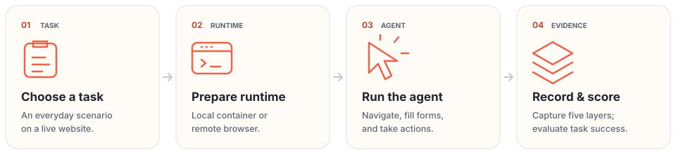

# Recording and runtime architecture

[← ClawBench](../README.md) · [中文](architecture.zh-CN.md)

##  How it works

<p align="center">
  <picture>
    <source media="(max-width: 1200px) and (prefers-color-scheme: dark)" srcset="../assets/workflow-mobile-dark.svg" width="460">
    <source media="(max-width: 1200px)" srcset="../assets/workflow-mobile-light.svg" width="460">
    <source media="(prefers-color-scheme: dark)" srcset="../assets/workflow-dark.svg">
    
  </picture>
</p>

<details>
<summary><b>Container internals</b></summary>

```
┌─────────────────────────────────────────────────┐
│  Container (Docker / Podman)                    │
│                                                 │
│  ┌──────────┐  CDP Fetch/Runtime/Page events    │
│  │ Chromium ├─────────────────────────────┐     │
│  │ :9222 CDP│                             │     │
│  └──────────┘                             │     │
│                                           │     │
│  ┌──────────┐            ┌────────────────▼─┐   │
│  │  Xvfb    │◄──ffmpeg──►│  FastAPI Server  │   │
│  │ :99      │  x11grab   │  :7878           │   │
│  └──────────┘            └──────────────────┘   │
│                                  │              │
│                          ┌───────▼─────────┐    │
│                          │     /data       │    │
│                          │  actions.jsonl  │    │
│                          │  requests.jsonl │    │
│                          │  screenshots/   │    │
│                          │  recording.mp4  │    │
│                          └─────────────────┘    │
└─────────────────────────────────────────────────┘
```

</details>
