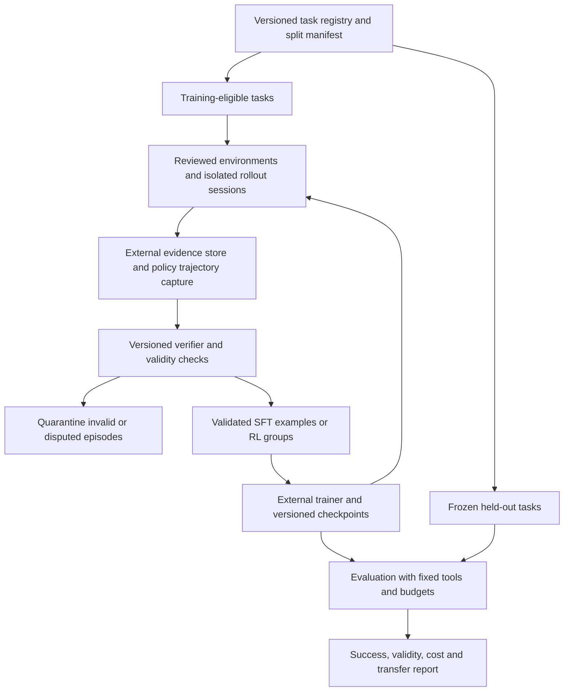

# ClawBench for CUA evaluation and post-training

Research assessment, 2026-10-23. Code and corpus audited at
[`07eb50a`](https://github.com/TIGER-AI-Lab/ClawBench/tree/07eb50a3d4c5a799f5ad4eebd57c67c10417787f).
This document separates implemented behavior, static integration risks, and
proposed experiments. It reports no new live-site scores or training gains.

## Decision

**ClawBench can anchor a real-web CUA evaluation and post-training pipeline.
It is not yet a complete, validated training pipeline or a comprehensive CUA
benchmark.** Its strongest assets are realistic websites, several agent
harnesses, five recording layers, offline rescoring, and existing Harbor and
ProRL/Polar rollout adapters. Reuse those rather than build a second runner.

The recommended scope is **real-web evaluation plus curated training rollouts**.
Desktop applications, OS state, and workflows across native applications need
complementary environments. Model training also needs a trustworthy verifier,
trainable trajectory capture, an external trainer, and evidence of held-out
improvement. Producing a reward file proves only one part of that chain.

For an initial investment, prioritize reward correctness and data isolation,
then a small SFT pilot, then RL on tasks that pass runtime and reward checks.
Keep a frozen evaluation set outside all training and curriculum generation.

## What exists today

| Capability | Evidence in this repository | Readiness and limit |
| --- | --- | --- |
| Isolated browser episodes, human demonstrations, several harnesses | [Single runner](../src/clawbench/runner/run.py), [harness registry](../src/clawbench/runtime/harnesses/harnesses.yaml) | Useful system evaluation; model, tools, and harness jointly determine results |
| Screenshots, actions, HTTP requests, video, agent messages | [Runtime server](../src/clawbench/runtime/runtime-server/server.py), [trace cookbook](trace-cookbook.md) | Rich evidence; not a canonical observation/action training dataset |
| Request interception before a matching request is sent | [Task schema](../test-cases/task.schema.json), runtime `start_cdp_handler` | Measures an attempted request; does not observe its server-side result |
| Native strict judge and offline strict/lenient rescoring | [Judge](../src/clawbench/runner/judge.py), [rescore](../src/clawbench/eval/rescore.py) | Reusable labels with rubric dependence; original V1 [human-reference evaluation](../eval/README.md) is a different protocol |
| Run identity and provenance | [Metadata](../src/clawbench/runner/run_support/metadata.py), [provenance](../src/clawbench/runner/run_support/provenance.py) | Code/corpus revisions, task/config hashes, image IDs and build pins already exist; best-effort nulls and unverified reused images remain possible |
| Batch execution, usage and failure reporting | [Batch runner](../src/clawbench/runner/batch.py), [usage](../src/clawbench/runner/run_support/usage.py), [results](../src/clawbench/runner/run_support/results.py) | Foundation for throughput/cost accounting; not measured training throughput |
| Harbor task packaging and verifier | [Adapter](../src/clawbench/eval/harbor_adapter.py), [verifier](../src/clawbench/runtime/harbor/verify.py) | Produces numeric metrics and reward artifacts; semantics differ from the native runner |
| Polar submission and policy endpoint routing | [Submission client](../src/clawbench/prorl/submit.py), [entry script](../src/clawbench/prorl/run-prorl.sh) | `num_samples`, shell harness, `prefix_merging`, Harbor evaluator; token capture and optimizer live upstream |

### Corpus audit

Counts below come from the audited checkout, not historical paper counts.
“Sites” means distinct literal `metadata.sites_involved` strings; it is not an
eTLD+1 normalization or a proof of independent environments.

| Corpus | Tasks | Sites | POST / GET / PUT / PATCH | Placeholder patterns | Body / params filters |
| --- | ---: | ---: | --- | ---: | --- |
| V1 | 152 | 143 | 148 / 0 / 3 / 1 | 82 | 7 / 0 |
| V2 | 129 | 63 | 118 / 10 / 1 / 0 | 0 | 9 / 1 |
| V1-Lite | 20 | 20 | 20 / 0 / 0 / 0 | 8 | 2 / 0 |

All 20 Lite task files resolve into V1. V1 and V2 share **50 numeric task IDs
and 43 literal site strings**. ID overlap alone does not prove identical task
content, but these suites are not ready-made train/test partitions. Deduplicate
instructions, task families, sites, references and derived traces before
splitting. Public benchmark traces also carry evaluation contamination risk.

V1's placeholder `__PLACEHOLDER_WILL_NOT_MATCH__` cannot provide a positive
interception reward. Lite inherits eight such tasks. Start any interception
reward pilot from a reviewed V2 subset; use V1 under its appropriate trajectory
rubric. A nonempty URL pattern is not evidence that it still matches the
intended production endpoint. V2 has no populated `judge_context` fields in
this snapshot, so default request judging has no task-specific hidden reference
from those fields.

## Evaluation validity: define the outcome being measured

There are three different outcomes:

1. **Request reached:** the browser attempted a URL/method/filter match.
2. **Intent verified:** the captured request contains sufficient evidence that
   the requested action and explicit constraints are correct.
3. **Effect verified:** an authorized test backend or other independent check
   confirms the resulting state or returned answer.

ClawBench's native request path supports the first two, with limits on the
second. The interceptor calls `Fetch.failRequest` and stops the episode after
the first match. A blocked purchase can demonstrate checkout intent without
demonstrating payment acceptance. A blocked GET can demonstrate requesting a
page without demonstrating reading it or answering a question about it.
Multi-stage tasks can also terminate before later requirements are observable.
Use task-specific outcome contracts; do not rename every intercepted request
“task completed.” The isolated [environmental-observation proposal](../test-cases/environmental-observation/README.md)
already distinguishes request initiation from data retrieval and validation.

### Scoring paths need an explicit contract

| Path | Current behavior | Consequence for training |
| --- | --- | --- |
| Native `clawbench-run` | Strict request judge after interception; `--no-judge` permits interception-only success | Persist judge mode; do not mix interception-only and verified labels |
| Offline `clawbench-rescore` | Supports strict and lenient rubrics | Version every derived label; compare the same rubric |
| Harbor `verify.py` | Computes both rubrics; primary scalar and `reward.txt` use **lenient** | Explicitly select and calibrate a training reward; “Harbor reward” does not mean strict success |
| Native judge outage | `match: null`, exit code 3; batch has `judge_inconclusive` | Existing distinction should be retained |
| Harbor missing configuration, judge outage or unparseable verdict | Missing configuration writes 0; `match is True` conversion also maps null to 0 | Quarantine invalid judgments rather than teach that these were policy failures |
| Polar reward consumption | Reads `reward.txt` first; falls back to averaging numeric `reward.json` fields | Preserve an explicit scalar; diagnostic metrics must not accidentally become reward components |

Harbor's lenient prompt explicitly accepts a missing specified time field when
the request does not contradict it. That can be useful as a permissive analysis
metric; optimizing it creates an incentive to omit evidence. Strict judging is
also not a ground-truth oracle: a product ID without an independent ID-to-item
mapping can be insufficient evidence under either rubric. Both request judges
truncate body text to 6,000 characters. Calibration should include required
fields beyond that boundary, multipart submissions, opaque IDs and GraphQL
operation disambiguation. These are failure hypotheses, not measured error
rates. See the [native judge](../src/clawbench/runner/judge.py) and
[Harbor verifier](../src/clawbench/runtime/harbor/verify.py).

Proposed training contract: retain separate `episode_status`, `verdict_status`,
`outcome_type`, `reward`, and `evidence_refs`. A valid policy failure can receive
0; an unavailable judge or corrupt evidence gets a null reward and is excluded
from the optimizer. Record the judge model, prompt/rubric hash, parser version,
task revision and scalar selection. A strict positive needs sufficient evidence
for every required constraint, or deterministic verification where feasible.
These fields and behavior are a proposal, not a current CLI feature.

### Fairness, repeatability and isolation

Publish separate tracks for screenshot/coordinate control, DOM/accessibility
control, and agents with code, shell or network tools. A model comparison must
hold harness, permitted tools, browser runtime, budgets and observation policy
fixed. Unrestricted harness comparisons measure complete systems. The recorder
does not enforce a common action/observation policy or prevent direct HTTP
shortcuts by an agent with shell/network access.

Fresh containers reset local state; they cannot reset production inventory,
accounts, rate limits, CAPTCHAs, geolocation or website deployments. Pin what can
be pinned, record what cannot, and rerun paired baselines in the same time
window. Offline rescoring reproduces a judgment over saved evidence; video or
request playback does not reconstruct an interactive website for RL branching.
Use controlled sites or authorized fixtures for repeatable training and live
sites for separately reported transfer tests.

The interceptor is a task-specific boundary, not a universal egress policy:
requests outside its filters continue. Training eligibility therefore needs a
reviewed task boundary, disposable resources, per-site concurrency limits and
an immediate stop on a recorder/interceptor failure. This follows directly
from the runtime's matching logic; no bypass experiment was performed.

For agents with shell access, also separate the recorder and verifier from the
agent's writable runtime. The Harbor adapter writes the **full** task JSON to
`workdir/task.json`, and Polar uploads that workdir to `/app`. A future hidden
`judge_context` would therefore be staged with the task even though it is not
in the prompt. Do not rely on prompt omission as access control. Keep hidden
references, verifier code and judge credentials outside policy-readable state;
collect authoritative evidence outside policy-writable `/data`. Exact access
depends on runtime permissions; this is a static trust-boundary finding, not
evidence that an existing run cheated.

## Post-training: what each route needs

| Route | Reusable asset | Additional requirement before a credible claim |
| --- | --- | --- |
| SFT / teacher distillation | Successful demonstrations and recorded messages | Harness adapters, actual pre-action observations, action targets, masks, provenance, quality checks and disjoint evaluation |
| Preference learning / DPO | Multiple attempts and outcome evidence | Comparable prompts/initial conditions, audited chosen/rejected pairs; do not rank a healthy run above an outage and call it preference data |
| Online RL / GRPO | Polar sampling, gateway routing and Harbor reward | Real policy tokens/logprobs/masks, multimodal fidelity, group identity, valid rewards, trainer/weight refresh, checkpoint and held-out evaluation |
| Process supervision | Actions, screenshots and failure traces | Human or validated process labels; a final episode label does not identify which step was correct |

A successful teacher trajectory is not automatically on-policy data for a
different student. SFT can use off-policy demonstrations; on-policy RL claims
require the generating checkpoint and sampling configuration. Never reconstruct
behavior logprobs from an unrelated model or turn terminal success into a
positive label for every action.

### Observation/action records

The runtime records DOM events and throttles asynchronous screenshot capture.
The screenshot triggered by a click need not be the image the policy saw
before deciding to click. One tool call may generate several DOM events; a
shell/HTTP action may generate none. Joining timestamps alone is insufficient
for a causal training example.

A proposed canonical episode should retain the original artifacts and add:

- Episode/task/split IDs, policy checkpoint, harness/tool versions, browser
  context and account/session identity.
- For each decision: the exact policy-visible observation and content hash,
  tool-call ID, action arguments, result, next observation, ordered step ID and
  timing; coordinates also need viewport, scale and coordinate space.
- For SFT: assistant targets and loss masks; for RL: sampled token IDs, behavior
  logprobs, loss masks, tokenizer/chat-template and multimodal processor versions,
  image references, stop/truncation reason and policy version.
- Auditable outcome evidence, verifier identity, validity status, costs and
  source permissions; remove credentials/session tokens from released data and
  verify the right to train on each source and provider output.

The browser artifact store and trainable policy trajectory serve different
purposes. Polar's gateway/builders can supply the latter; verify that the chosen
VLM backend and harness preserve exact image inputs and sampled tokens. Its
`prefix_merging` builder can split a trajectory after context compaction, so
the trainer must define reward attribution across resulting traces. Upstream
documents the [builder and loss-mask semantics](https://github.com/NVIDIA-NeMo/ProRL-Agent-Server/blob/45feeffe9aa9e40a3d26b8addfcb22b3eb05d0d5/src/polar/trajectory/builder/README.md).

### Polar is an integration starting point

The current [mock tests](../tests/test_prorl_mock.py) run stub verifier scripts
and check submit/poll/reward transport. They do not execute browser setup,
policy inference, token capture or optimizer updates. The [existing runbook](prorl-rl-env.md)
reports prior live rollouts, including a positive reward; those are useful
historical reports, not a new reproduction or evidence of learning here.

Two current static integration risks need real-runtime checks before scaling:

- `build_task_request` uploads workdir files under `/app`, while the generated
  Harbor `setup.sh` reads `/task.json`; the runtime reads `/eval-schema.json`.
  The submission path does not explicitly stage those root-level files. Verify
  the actual image/runtime mappings and fix the path contract before claiming
  that today's staged payload boots successfully.
- `RuntimeSpec` defaults to `network="host"`; runtime scripts use fixed ports
  7878/9223 and related browser/display ports. Concurrent sessions on the same
  host need separate network namespaces or assigned endpoints. `num_samples=8`
  is not evidence that eight browser sessions run independently.

Sources: [payload models](../src/clawbench/prorl/models.py),
[submission](../src/clawbench/prorl/submit.py),
[generated setup](../src/clawbench/eval/harbor_adapter.py),
[runtime startup](../src/clawbench/runtime/harbor/start-runtime.sh).
No production gateway/container test was run for this assessment.

## Comparison with complementary research

This is a capability comparison, not a ranking of reported success rates.
Results from different task sets, policies and budgets are not comparable.

| Source | Relevant contribution | Implication for ClawBench |
| --- | --- | --- |
| [WebArena](https://arxiv.org/abs/2307.13854) | Self-hosted realistic web environments with functional task evaluation | Use controlled backends where reset and final-state verification matter |
| [WebArena-Verified](https://github.com/ServiceNow/webarena-verified/blob/main/docs/index.md) | Audited tasks, structured deterministic scoring and offline network-event checks | Adopt typed predicates and evaluator/dataset checksums for suitable tasks; offline grading still does not reset a live site |
| [BrowserGym](https://arxiv.org/abs/2412.05467) and [AgentLab](https://github.com/ServiceNow/AgentLab) | Common web environment interfaces and experiment management | Reuse common contracts instead of making every harness define scoring semantics |
| [OSWorld](https://arxiv.org/abs/2404.07972) | Real desktop, file and multi-application tasks with execution-based evaluation | Complement browser coverage before making general CUA claims |
| [WebRL](https://arxiv.org/abs/2411.02337) | Online curriculum, outcome rewards and adaptation to policy drift | A fixed evaluation corpus and a rollout transport alone do not provide a curriculum or learning algorithm |
| [WebGym](https://arxiv.org/abs/2601.02439v6) | Large real-web task pool, asynchronous rollouts and evaluation on unseen websites | Task diversity, throughput and site-disjoint transfer need explicit experiments |
| [AsyncWebRL](https://arxiv.org/abs/2606.05597v3) | Overlapping rollout/training/refresh and studying trajectory-length effects | Measure useful samples and end-to-end learning throughput, including long failures |
| [ProRL/Polar Harbor evaluator](https://github.com/NVIDIA-NeMo/ProRL-Agent-Server/blob/45feeffe9aa9e40a3d26b8addfcb22b3eb05d0d5/src/polar/trajectory/evaluator/harbor.py) | Grades the live runtime and reads a scalar reward | Reuse transport; independently validate token fidelity, reward validity and trainer behavior |

Sources checked on 2026-10-23. The architectural recommendations above are this
assessment's inferences from the repository and these primary sources.

## Proposed pipeline



Held-out tasks, their traces, answers and evaluator feedback must not feed the
trainer, reward-model tuning or curriculum generator. Keep a development
validation split for those decisions and run the frozen test at declared
milestones. Group sites by registrable domain/platform and task family; inspect
cross-site shared templates and accounts rather than splitting rows randomly.

Start with SFT because it exposes observation/action conversion and data quality
problems without simultaneously debugging policy-gradient training. Add RL
after reward validity and trajectory fidelity pass. Keep a pure evaluation
mode so ClawBench remains useful to users who never train a model.

## Experiments and acceptance criteria

These are proposed pilot gates, not achieved metrics or guarantees. Freeze the
task manifest, label policy, exclusions and budgets before collecting data.

| Stage | Experiment | Evidence required to proceed |
| --- | --- | --- |
| P0: reward audit | Audit at least 100 real or curated edge-case episodes with two independent annotators and adjudication; compare strict, lenient and deterministic predicates | Publish confusion matrices, false-positive/negative rates, agreement and bootstrap/Wilson intervals; proposed target ≤5% observed false positives on valid labeled negatives, with sample sizes and uncertainty disclosed |
| P0: failure semantics | Inject judge timeout/malformed reply, absent capture and invalid setup | Every injected infrastructure/judge failure excluded from trainable rewards; valid agent failures retained |
| P0: trust boundary | In a controlled fixture, test direct HTTP shortcuts, task-file/reference reads and attempted evidence mutation | Report which actions are allowed per track; authoritative evidence and hidden references remain protected in the selected training mode |
| P1: runtime contract | Boot the actual staged Polar payload, then 8 concurrent sessions; include a controlled passing and failing task | Correct task/schema paths, interceptor readiness, distinct browsers/accounts/artifacts/endpoints, and matching expected rewards |
| P1: trainable traces | Capture multiple policy turns, image inputs, tool results, a retry and compaction | Verify sampled token/logprob/mask alignment, prompt/image hashes, no judge tokens in policy loss, and checkpoint identity against the backend |
| P2: SFT pilot | Use newly separated training tasks; compare base vs SFT under the same harness/budgets on development and held-out sites | Reproducible dataset manifest/checkpoint, valid-action rate, held-out success with uncertainty, costs and audited failures; no gain claimed from training-task performance |
| P3: RL pilot | Compare base, SFT, and SFT+RL; run at least 3 training seeds where feasible | Reward/invalid-group statistics, stable finite losses, policy refresh evidence and held-out improvement; extra rollout budget accounted for |

For evaluation, use at least three attempts per task in the pilot, pair model
runs within site/time windows and report task- or site-clustered uncertainty.
The same site's attempts are correlated. Keep all scheduled tasks in the
accounting: publish success/total scheduled, valid/total scheduled,
success/valid, and separate infra, judge, site-blocked and policy-failure counts.
Do not silently improve a score by dropping inaccessible tasks. Whether an auth
or CAPTCHA wall is a policy failure or environment exclusion must follow the
predeclared task/track contract, not a post-hoc judgment favoring a model.

RL groups require the same task, comparable initial conditions and generating
policy version. Reject/retry invalid groups under a declared sampling policy.
Log all-zero and all-one reward groups: they provide no relative outcome signal
for standard within-group normalized advantages. On non-resettable live sites,
record the limitation and avoid attributing group differences solely to policy.

Measure useful validated episodes/hour, policy tokens/second, browser-minutes,
judge calls, storage, token costs and p50/p95 episode duration. A rough capacity
model is `episodes/hour = 60 * concurrent_sessions / mean_episode_minutes`;
useful throughput multiplies this by the measured usable-episode fraction.
For example, 16 sessions at 10 minutes yield an ideal 96 episodes/hour, or 72
at a hypothetical 75% usable rate. These are illustrative inputs, not a ClawBench
measurement; training GPU time, queueing and verifier overhead are additional.

## Implementation order

1. **Unify verdict validity and reward selection.** Extend the shared result
   contract across native/Harbor/Polar paths; test null judgments and keep
   diagnostics separate from optimizer reward. Calibrate before changing any
   public leaderboard definition.
2. **Close runtime and trust-boundary gaps.** Align staging paths, isolate
   concurrent sessions, move protected task context and authoritative capture
   outside agent write access, and run the real gateway smoke test.
3. **Add split manifests and trajectory conversion.** Version train/dev/test
   membership and content hashes; implement one harness's exact observation and
   action export before generalizing. Audit source permissions and redact data.
4. **Run the SFT comparison, then the RL comparison.** Reuse Polar and an external
   trainer. Publish commands, image/checkpoint IDs, manifests, learning curves,
   failure counts and held-out results before describing the loop as validated.
5. **Broaden coverage with complementary environments.** Add desktop and
   multi-application evaluation only with their own reset/effect verifiers.

This research PR proposes that order; it does not implement those runtime or
training changes.

## Reproducing this assessment

The corpus table can be regenerated from the repository root:

```python
import collections
import json
from pathlib import Path

audits = {}
for suite in ("v1", "v2", "v1-lite"):
    files = sorted((Path("test-cases") / suite).glob("*/task.json"))
    tasks = [json.loads(path.read_text()) for path in files]
    sites = {site for task in tasks for site in task["metadata"]["sites_involved"]}
    ids = {task["metadata"]["task_id"] for task in tasks}
    schemas = [task["eval_schema"] for task in tasks]
    audits[suite] = (sites, ids)
    print(suite, len(tasks), len(sites),
          dict(collections.Counter(schema["method"] for schema in schemas)),
          sum(s.get("url_pattern") == "__PLACEHOLDER_WILL_NOT_MATCH__" for s in schemas),
          sum(bool(s.get("body")) for s in schemas),
          sum(bool(s.get("params")) for s in schemas),
          sum(bool(t.get("judge_context")) for t in tasks))
print("V1/V2 shared IDs:", len(audits["v1"][1] & audits["v2"][1]))
print("V1/V2 shared sites:", len(audits["v1"][0] & audits["v2"][0]))
lite = list(Path("test-cases/v1-lite").glob("*/task.json"))
print("Lite symlinks:", sum(p.is_symlink() for p in lite))
print("Lite resolves into V1:", all(
    p.resolve().is_relative_to(Path("test-cases/v1").resolve()) for p in lite))
```

Offline verification for this assessment:

```bash
uv run --frozen pytest tests/test_prorl_models.py tests/test_prorl_mock.py \
  tests/test_prorl_submit.py tests/test_harbor_adapter.py \
  tests/test_run_judge_stage.py tests/test_batch_judge_inconclusive.py \
  tests/test_provenance.py -q
python3 scripts/ci/check_markdown_links.py
git diff --check
```

The selected tests passed (61 tests). They validate existing local contracts,
not the proposed gates. No live website interaction, production Polar gateway,
GPU training, new dataset download or model-provider call was needed for this
assessment. Actual reset stability, judge accuracy, token fidelity, throughput
and learning gains remain empirical questions.
