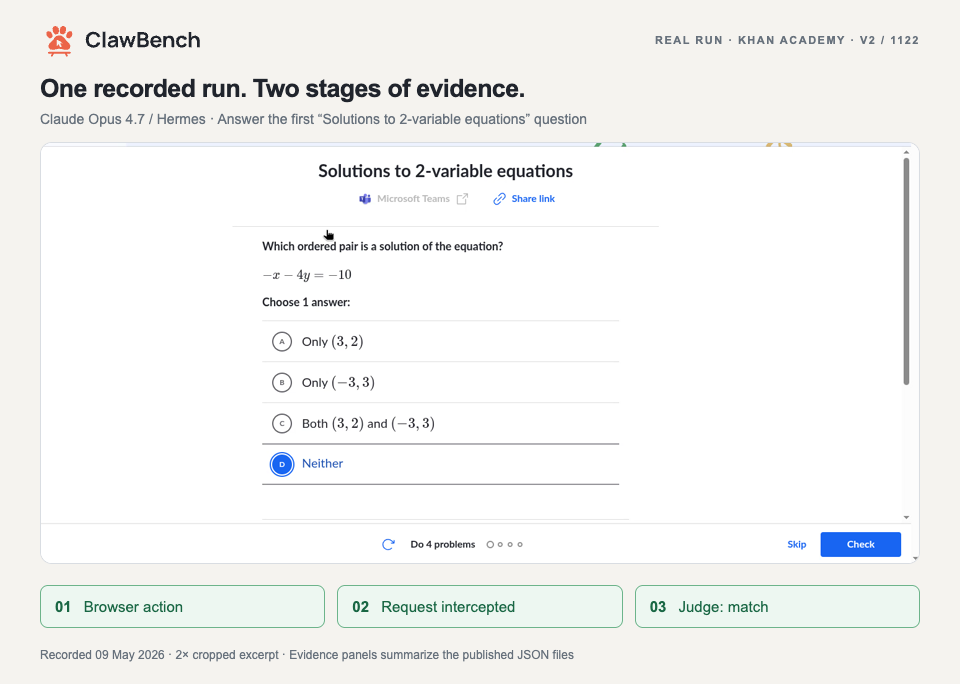

# A real run: answer, intercept, judge

[← ClawBench](../README.md) · [中文](demo.zh-CN.md)

This is a recorded **Claude Opus 4.7 / Hermes** run on **Khan Academy**, task **V2-1122**, published in ClawBench V2 Traces. The task asks the agent to open Algebra 1 → Linear equations & graphs → Solutions to 2-variable equations and answer the first practice question.

[](../assets/demo/task-1122.mp4)

[Play / pause the MP4](../assets/demo/task-1122.mp4) · [Animated GIF](../assets/demo/task-1122.gif) · [Full 3:38 recording](https://huggingface.co/datasets/TIGER-Lab/ClawBenchV2Trace/blob/bb88da2b8a94044df7888d79c1ad4c7e88949043/batch-20260509-202734/claude-opus-4-7/hermes-v2-1122-education-course-khanacademy-claude-opus-4-7-20260509-233452/data/recording.mp4)

## What the excerpt shows

| Step | Recorded evidence |
| --- | --- |
| Select an answer | The action log records option **D** at `2026-05-09T23:35:53.131Z`. |
| Click **Check** | The next submission click is recorded at `2026-05-09T23:35:59.287Z`. |
| Intercept the request | `intercepted: true`; `POST` to `/api/internal/graphql/attemptProblem`; `operationName: attemptProblem`; `problemNumber: 1`. |
| Read the judge result | The published `judge.json` stores `match: true`, judged by `deepseek/deepseek-v4-pro`. |

The saved judge reason says the request submits an answer to the first problem in the requested exercise. This page reproduces that saved verdict. Its lenient/strict rubric metadata is unspecified.

## Editing and attribution

The browser footage is an excerpt of the published recording, from **00:51 to 01:08**, cropped to the exercise area and played at **2× speed**. It is followed by **3 seconds** of request evidence and **4 seconds** of judge evidence, producing a **15.5-second** edit. The two evidence panels are editorial summaries of the saved JSON files. The full recording includes additional navigation and retries.

Recording source: [TIGER-Lab/ClawBenchV2Trace](https://huggingface.co/datasets/TIGER-Lab/ClawBenchV2Trace), whose dataset card lists Apache-2.0. The filmed interface is Khan Academy. The README offers a static poster for reduced-motion preferences and a pauseable MP4.

The panels display the endpoint, method, operation name, problem number, and verdict. Complete evidence is available in the source files below.

## Pinned source

Dataset revision: `bb88da2b8a94044df7888d79c1ad4c7e88949043`. The [machine-readable manifest](../assets/demo/source.json) also records the edit and displayed evidence.

| Source file | SHA-256 |
| --- | --- |
| [recording.mp4](https://huggingface.co/datasets/TIGER-Lab/ClawBenchV2Trace/blob/bb88da2b8a94044df7888d79c1ad4c7e88949043/batch-20260509-202734/claude-opus-4-7/hermes-v2-1122-education-course-khanacademy-claude-opus-4-7-20260509-233452/data/recording.mp4) | `23f9c7a33184378ac1b410a508428d5eaf0461f317ba5513c6472f93416bfda4` |
| [actions.jsonl](https://huggingface.co/datasets/TIGER-Lab/ClawBenchV2Trace/blob/bb88da2b8a94044df7888d79c1ad4c7e88949043/batch-20260509-202734/claude-opus-4-7/hermes-v2-1122-education-course-khanacademy-claude-opus-4-7-20260509-233452/data/actions.jsonl) | `65c72e322f87f40af41d0aca0a4a48f0e46ce14f88d3ba55fb1aae8e87e629cd` |
| [interception.json](https://huggingface.co/datasets/TIGER-Lab/ClawBenchV2Trace/blob/bb88da2b8a94044df7888d79c1ad4c7e88949043/batch-20260509-202734/claude-opus-4-7/hermes-v2-1122-education-course-khanacademy-claude-opus-4-7-20260509-233452/data/interception.json) | `649ad2c3fb60726f9e4eb3fb87337eeb95f5ad9186a8bad23c36c60a9a5bc03b` |
| [judge.json](https://huggingface.co/datasets/TIGER-Lab/ClawBenchV2Trace/blob/bb88da2b8a94044df7888d79c1ad4c7e88949043/batch-20260509-202734/claude-opus-4-7/hermes-v2-1122-education-course-khanacademy-claude-opus-4-7-20260509-233452/data/judge.json) | `3552351f293b5427b54147c4b824374d8494e662193959d0aac03f7053459734` |

## Why both stages matter

In a separate [V2-1033 navigation run](https://huggingface.co/datasets/TIGER-Lab/ClawBenchV2Trace/blob/bb88da2b8a94044df7888d79c1ad4c7e88949043/batch-20260509-202734/claude-opus-4-7/hermes-v2-1033-education-learning-registration-khanacademy-claude-opus-4-7-20260509-230313/data/interception.json), interception succeeded but the [saved judge verdict](https://huggingface.co/datasets/TIGER-Lab/ClawBenchV2Trace/blob/bb88da2b8a94044df7888d79c1ad4c7e88949043/batch-20260509-202734/claude-opus-4-7/hermes-v2-1033-education-learning-registration-khanacademy-claude-opus-4-7-20260509-230313/data/judge.json) was `match: false`: the captured URL opened a related article rather than the requested lesson. Interception and judged task completion are distinct outcomes; report both.

## Rebuild the media

Run from the repository root. The builder verifies all four source hashes and the displayed evidence before rendering. Downloaded source material stays in your chosen local directory. To use a locally installed Chrome instead of Playwright's browser, pass `--browser-executable /path/to/chrome`.

```bash
uvx --from huggingface_hub hf download TIGER-Lab/ClawBenchV2Trace \
  "batch-20260509-202734/claude-opus-4-7/hermes-v2-1122-education-course-khanacademy-claude-opus-4-7-20260509-233452/data/recording.mp4" \
  "batch-20260509-202734/claude-opus-4-7/hermes-v2-1122-education-course-khanacademy-claude-opus-4-7-20260509-233452/data/actions.jsonl" \
  "batch-20260509-202734/claude-opus-4-7/hermes-v2-1122-education-course-khanacademy-claude-opus-4-7-20260509-233452/data/interception.json" \
  "batch-20260509-202734/claude-opus-4-7/hermes-v2-1122-education-course-khanacademy-claude-opus-4-7-20260509-233452/data/judge.json" \
  --repo-type dataset --revision bb88da2b8a94044df7888d79c1ad4c7e88949043 --local-dir ./demo-source

uv run --no-project --with playwright --with imageio-ffmpeg \
  python -m playwright install chromium
uv run --no-project --with playwright --with imageio-ffmpeg \
  python assets/demo/build_demo.py \
  --source-dir "./demo-source/batch-20260509-202734/claude-opus-4-7/hermes-v2-1122-education-course-khanacademy-claude-opus-4-7-20260509-233452/data"
```
